# Animation screenshots (PR develop/)

AvatarSample_A · 19 clips · 2026-11-14T09-05-06

## booth-01-ShowFullBody

`develop/addons/pending/vrma-booth-vroid/ok/VRMA_01.vrma` — played: true

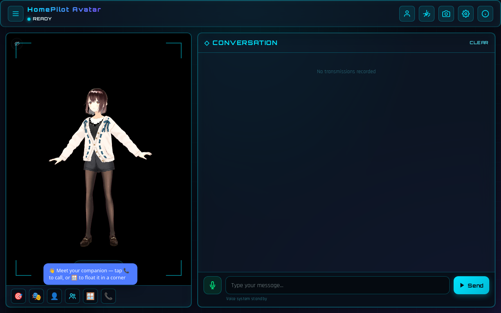

## booth-03-PeaceSign

`develop/addons/pending/vrma-booth-vroid/ok/VRMA_03.vrma` — played: true

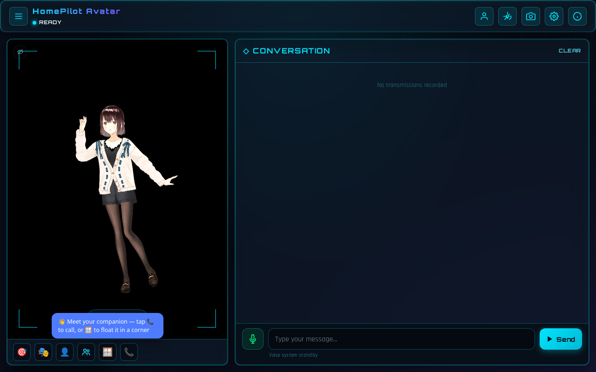

## booth-04-Shoot

`develop/addons/pending/vrma-booth-vroid/ok/VRMA_04.vrma` — played: true

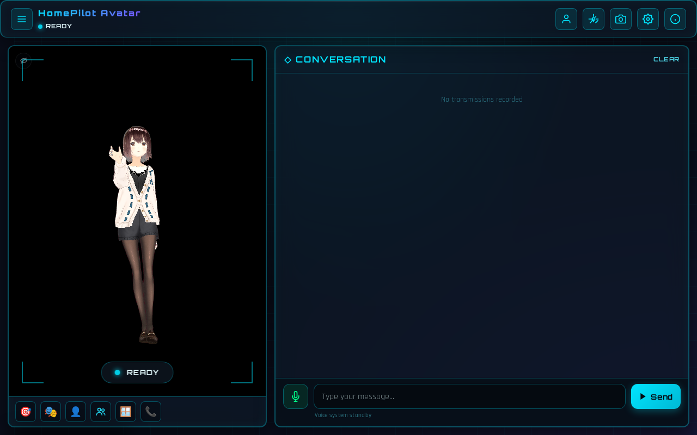

## booth-05-Spin

`develop/addons/pending/vrma-booth-vroid/ok/VRMA_05.vrma` — played: true

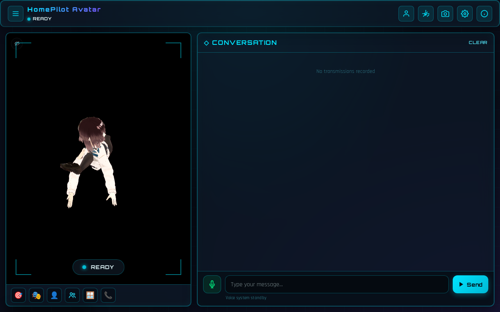

## booth-06-ModelPose

`develop/addons/pending/vrma-booth-vroid/ok/VRMA_06.vrma` — played: true

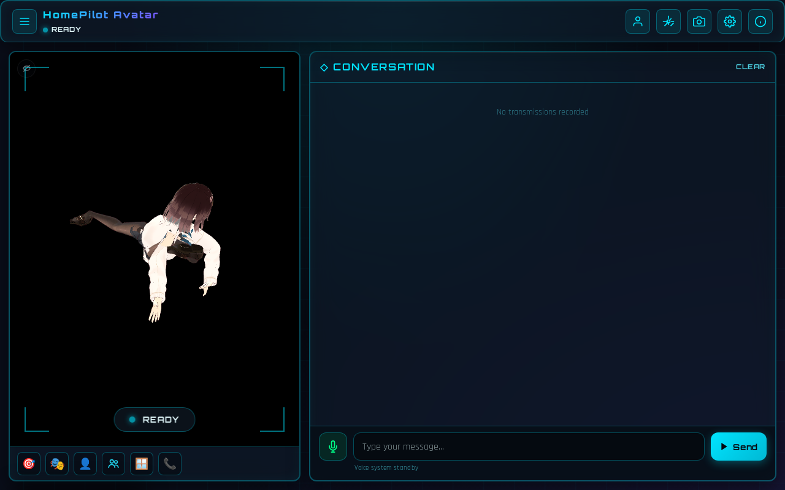

## booth-07-Squat

`develop/addons/pending/vrma-booth-vroid/ok/VRMA_07.vrma` — played: true

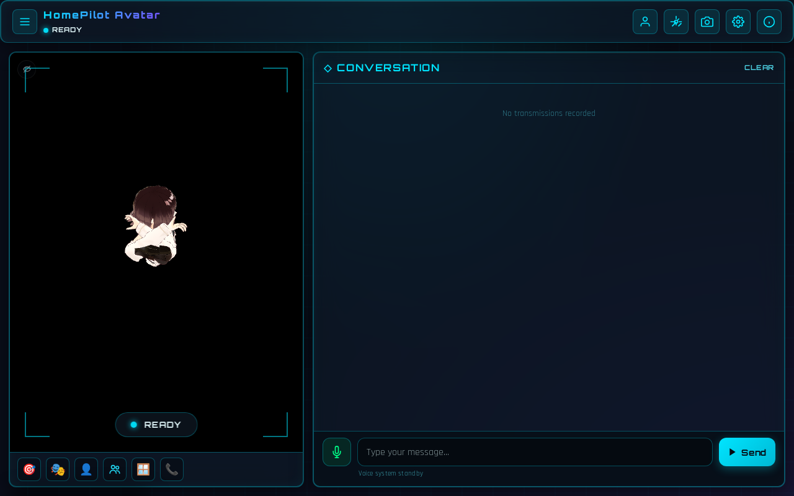

## mocopi-154241

`develop/addons/pending/vrma-mocopi-tfuru/MCPM_20230806_154241.vrma` — played:
true

## mocopi-154323

`develop/addons/pending/vrma-mocopi-tfuru/MCPM_20230806_154323.vrma` — played:
true

## mocopi-154402

`develop/addons/pending/vrma-mocopi-tfuru/MCPM_20230806_154402.vrma` — played:
true

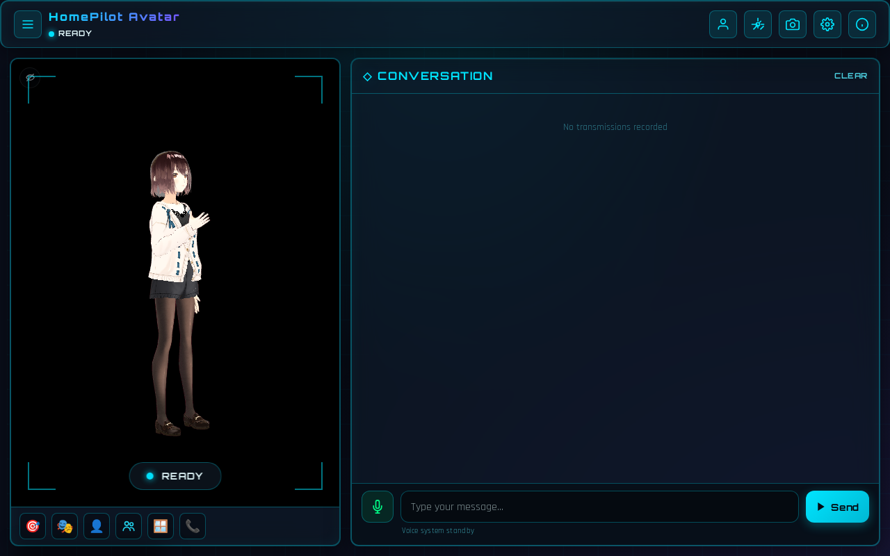

## mocopi-154429

`develop/addons/pending/vrma-mocopi-tfuru/MCPM_20230806_154429.vrma` — played:
true

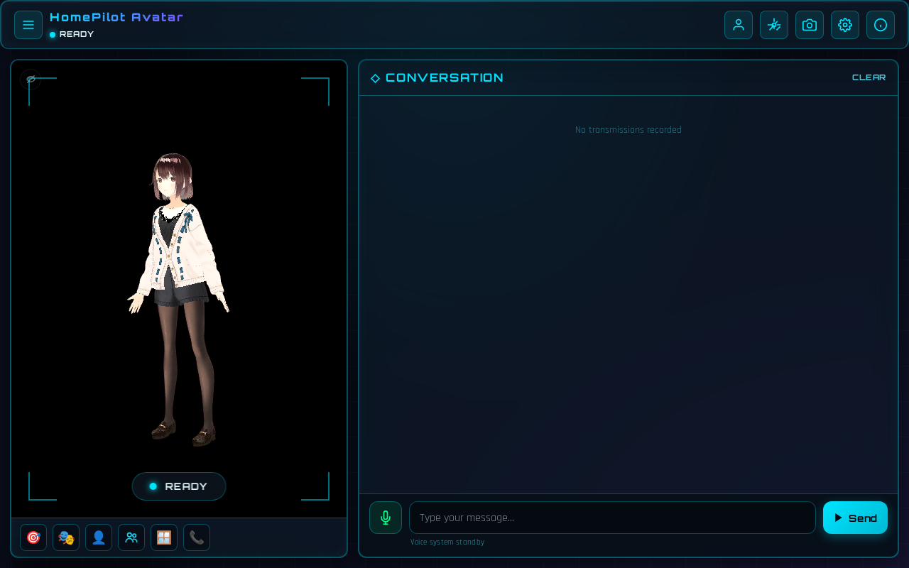

## mocopi-154455

`develop/addons/pending/vrma-mocopi-tfuru/MCPM_20230806_154455.vrma` — played:
true

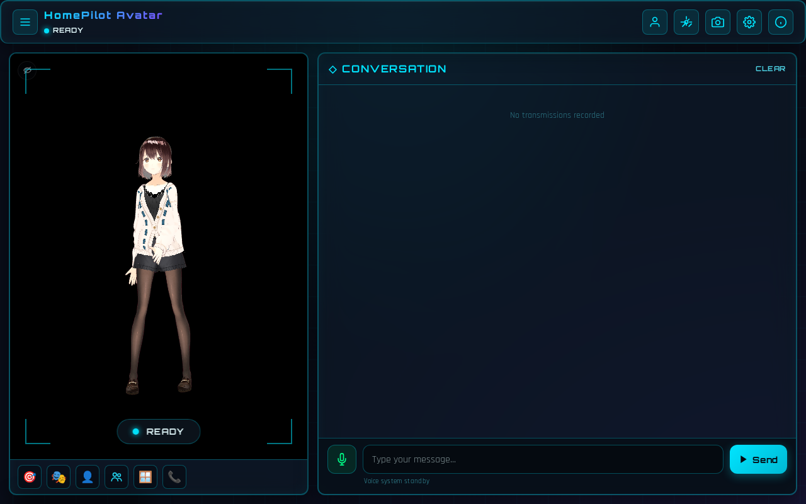

## stable-mit-idle_loop

`develop/addons/stable/vrma-mit/idle_loop.vrma` — played: true

## stable-mit-test

`develop/addons/stable/vrma-mit/test.vrma` — played: true

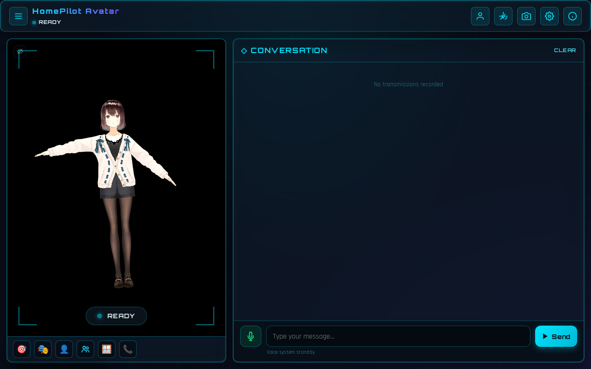

## stable-tk256-Blush

`develop/addons/stable/vrma-tk256-candidates/Blush.vrma` — played: true

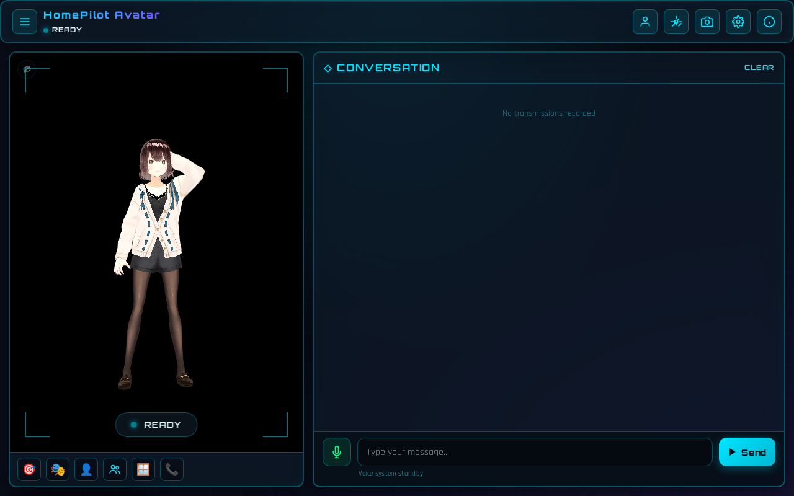

## stable-tk256-Clapping

`develop/addons/stable/vrma-tk256-candidates/Clapping.vrma` — played: true

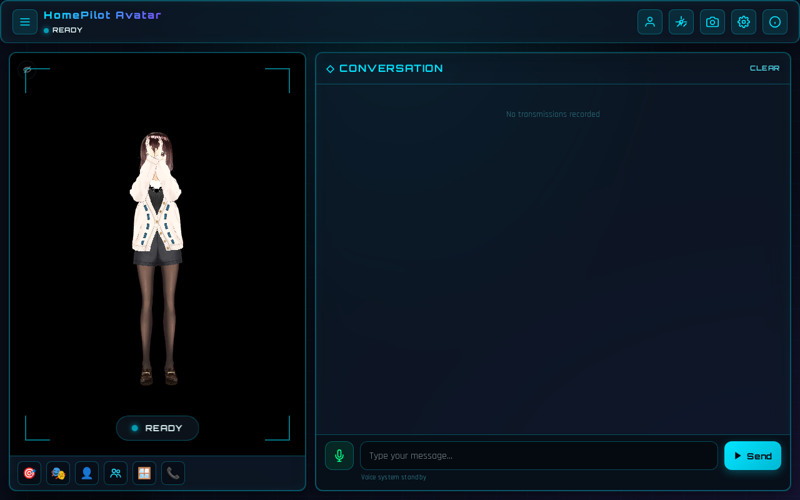

## stable-tk256-Goodbye

`develop/addons/stable/vrma-tk256-candidates/Goodbye.vrma` — played: true

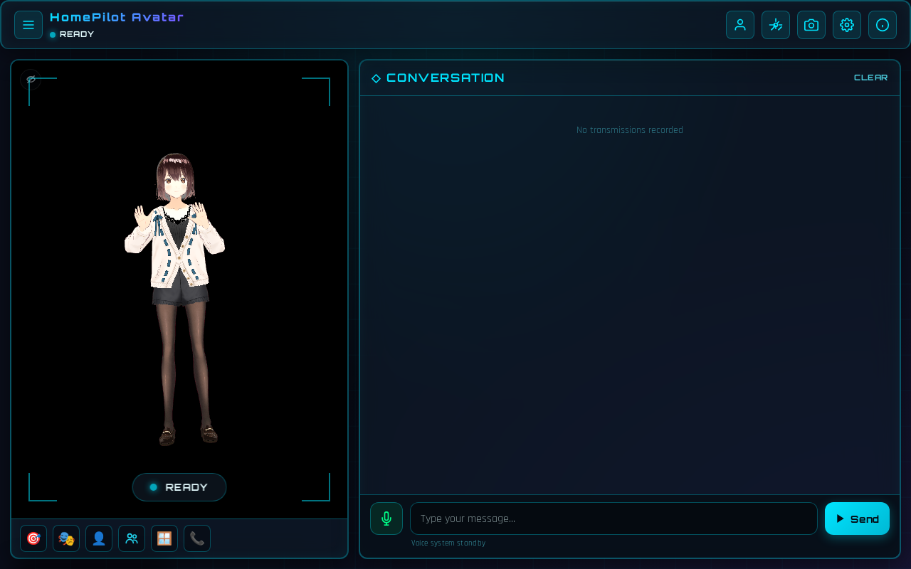

## stable-tk256-Jump

`develop/addons/stable/vrma-tk256-candidates/Jump.vrma` — played: true

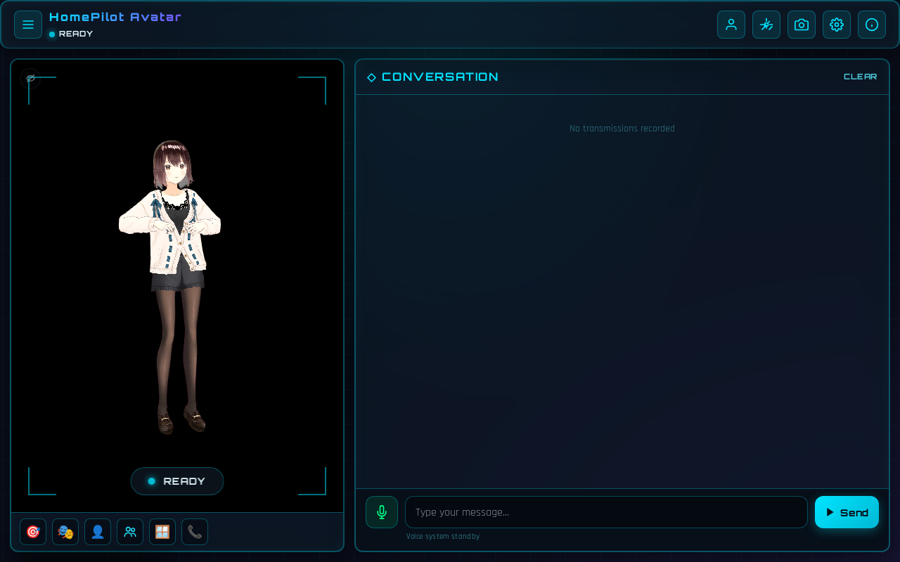

## stable-tk256-LookAround

`develop/addons/stable/vrma-tk256-candidates/LookAround.vrma` — played: true

## stable-tk256-Sleepy

`develop/addons/stable/vrma-tk256-candidates/Sleepy.vrma` — played: true

