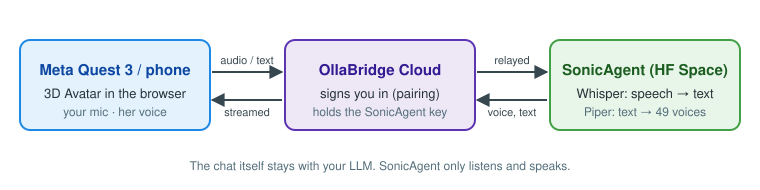
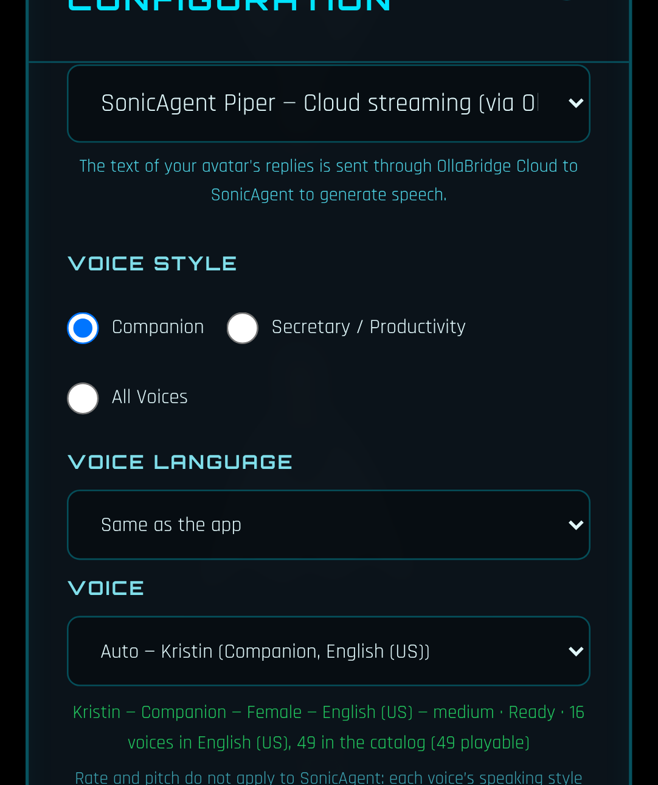
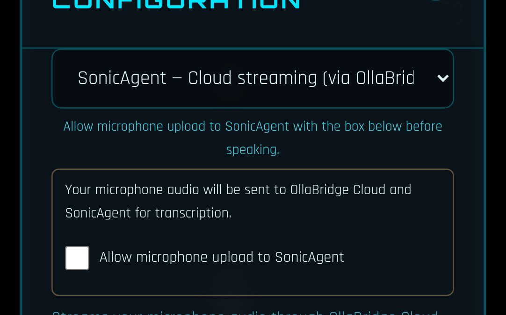
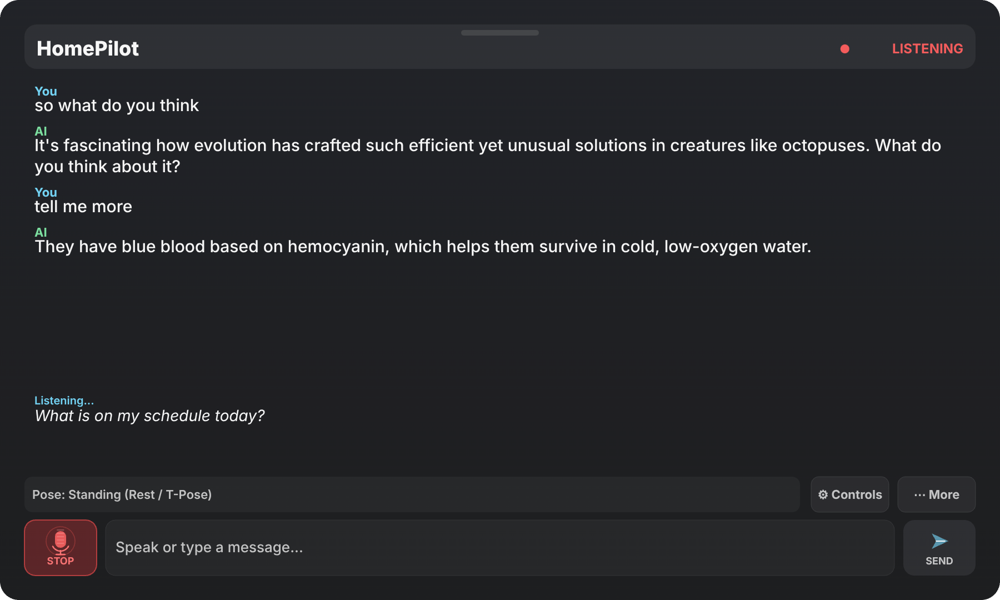

# SonicAgent voice — quick start (phone, PC, Meta Quest 3)

SonicAgent gives the avatar a natural voice (49 voices, 6 languages) and accurate speech
recognition, running on a Hugging Face Space. Your device only streams audio, so it works on a
Meta Quest 3 without downloading any model.

The conversation itself still comes from your LLM. SonicAgent only **listens** and **speaks**.

## 1. Connect OllaBridge (once)

Settings ▸ **LLM** ▸ OllaBridge Cloud ▸ pair your device. Voice uses the same connection.

## 2. Her voice

Settings ▸ SPEECH ▸ **TTS ENGINE** = _SonicAgent Piper — Cloud streaming_. Pick a style and a
language — the VOICE list shows only that language's voices — or leave **Auto**. Press
**TEST VOICE**.

- **Companion** — warm and slower (Kristin in English, Paola in Italian).
- **Secretary / Productivity** — clear and quicker (Lessac in English).

## 3. Your microphone (optional)

Settings ▸ **STT PROVIDER** = _SonicAgent — Cloud streaming_, then tick **Allow microphone
upload to SonicAgent**. Nothing is uploaded until you tick it. Check it with **MICROPHONE TEST**.

## 4. On Meta Quest 3

1. Open the app in the **Quest Browser** and do steps 1–3 in Settings (the page looks the same as
   on a PC).
2. Press **ENTER VR**.
3. **Hold the right trigger** and speak; **let go** to send. The panel shows _Listening…_, then
   your words, and she answers in the voice you picked.

## Good to know

- The first sentence in a new voice takes about 2–3 s while the server loads it; after that,
  replies start in 0.1–0.5 s.
- If SonicAgent can't be reached, Settings says why and keeps your choice. To have her use a
  voice on the device instead, tick ADVANCED VOICE ▸ _If the remote voice fails before speaking,
  use Piper on this device_.
- To stop sending anything, set TTS ENGINE and STT PROVIDER back to the browser options, or untick
  the microphone box.

More detail: [SONICAGENT_VOICE.md](SONICAGENT_VOICE.md).
