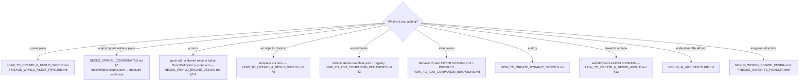

# AI coder — start here

You are about to change NEXUS: the 3D companion app in this repository. This
page tells you what to read, what to touch, and what to run, for each kind of
change.

**Read `CLAUDE.md` at the repository root first.** It has the repository's rules:

- the two module conventions
- the files you must never touch
- batch prefixes in comments and commit subjects
- the gate (`npm run validate` must stay exit 0)

## The five rules that are never optional

1. **The model proposes; trusted code executes; the renderer confirms.** A
   reply tag is never permission.
2. **Never narrate what did not happen.** If an asset, clip or actuator does
   not exist, the feature is `unavailable` and she suggests rather than
   claims.
3. **Measured, not typed.** Positions come from `tools/vr/measure-spots.mjs`
   with the model's SHA-256. Triangles come from the recipe tool. Nothing is
   eyeballed.
4. **Privacy boundaries hold:**
   - Private worlds and behaviour live only behind Private's gates.
   - Copilot gets no romance.
   - Data can narrow access, never grant it.
5. **One owner per subsystem.** No second render loop, mixer, camera
   controller, TTS or lip-sync. Snapshot and restore; drop stale async work by
   generation.

## Decision tree



## Where things live

| Concern | Files |
| --- | --- |
| World catalogue | `assets/vr-worlds/worlds.json`, `src/gltf-viewer/VRWorlds.js` |
| Scenes, kits, provenance | `assets/vr-worlds/scenes/`, `kits/`, `PROVENANCE.md` |
| Spots | `tools/vr/spot-targets.json` → `tools/vr/measure-spots.mjs` → `assets/vr-worlds/spots/*.json`, read by `src/gltf-viewer/WorldSpots.js` |
| Where you are, moves, travel | `src/companion/WorldPresence.js` |
| Prompt context | `src/companion/PromptContext.js`, `src/companion/index.js` |
| Venues | `src/experiences/playgrounds/` (template, router, picker, reactive) |
| Behaviour routing | `src/companion/BehaviorRouter.js`, `src/behavior/boot.js` (`NEXUS_BD`) |
| Stories | `src/experiences/` (Seaside), `src/features/together/activities/playground.js` (Scene Tale) |
| Camera framing | `src/gltf-viewer/CameraPresets.js` |
| Tests | `tests/living-worlds/`, `tests/vr-*.test.js`, `tests/playground*.test.js`, `tests/companion/` |

## Templates and tutorials

- **Templates:** `docs/engine/templates/`. Each one says EXISTS, PARTIAL or
  PROPOSED.
- **Tutorials:**
  - `tutorials/A_PREMIUM_APARTMENT.md`: how the apartment was really built
  - `tutorials/B_NIGHTCLUB.md`
  - `tutorials/C_FOREST_ADVENTURE.md`
- **A prompt to start a new world:** `PROMPT_CREATE_NEW_WORLD.md`.

## Always run

```bash
npx jest tests/living-worlds tests/engine-docs.test.js
npm run validate
node scripts/behavior-parity-baseline.mjs --check
```

**Then walk it in the real app** (`npm start`, headless Chromium), and with a
real model if the change touches conversation. **Report hardware results only
from hardware.**
