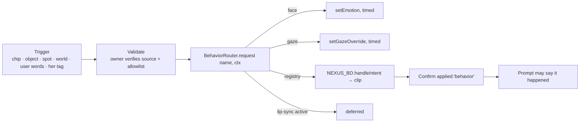

# How to add companion behaviours

**Version:** 1.0, 2026-11-07.

**Read first:** `NEXUS_AI_ARCHITECTURE.md` §7–§9 for routing, owners and
confirmation.

## 1. The path every behaviour takes



- **One entry point:** `src/companion/BehaviorRouter.js` `request(name, ctx)`.
  `name` must be in `INTENTS`.
- **Routing:** `CHANNELS` decides whether a behaviour is a face, a gaze, or a
  **declared** registry intent. An undeclared name ranks all 166 clips
  lexically and picks something unrelated: PG3 found `smile` playing the
  arm-waving clip.
- **Only `applied: 'behavior'` may be described to the model.**
  `fallback`, `deferred` and `none` must not be.

## 2. Ownership and conflicts

| Owner | Holds | Rule |
| --- | --- | --- |
| Behavior Director scheduler | body clips | one full-body clip at a time |
| Playground router | venue clip chips (dance, wave, bow) | while a clip owns the body (`PROFILES.owns`) nothing else is requested; `afterOwn` runs once when it stops |
| BehaviorRouter actuators | face, gaze | token-guarded: the later writer wins; timed reset |
| Lip-sync | mouth | body requests defer while she speaks |
| VRPoseSystem | skeleton in VR puppeting | `claimBones` / `releaseBones` snapshot and restore |
| Study block (`quiet`) | everything except `listen` | the reactive context refuses others |

**Priority and interruption today:**

- The reactive context throttles to 4 Hz, with per-intent cooldowns, at most
  6 a minute, and a 4 s staleness limit.
- A one-shot clip chip clears the queue.
- A world change drops everything by generation.

## 3. Recipe: add a behaviour

1. **Does the motion exist?** Search `kb/animations.manifest.jsonl` for a clip
   whose *description* matches and whose `intents` include a registry intent.
   - If none exists, stop and use face or gaze. If neither fits, the
     behaviour is `unavailable`.
2. **Add the companion intent** to `BehaviorRouter.INTENTS`:
   `{ mouthSafe, locomotion? }`.
3. **Route it** in `BehaviorRouter.CHANNELS`:
   - `{ face, intensity, ms }`
   - `{ gaze: 'user' | 'target', ms }`
   - `{ registry: '<declared intent>' }`
   - `{}` for "nothing fits yet"
4. **Trigger it from an owner:**
   - a venue chip: `PROFILES[venue].actions`
   - an arrival or spot: the reactive context or `WorldPresence`, e.g. after
     `nexus-world-spot`
   - her reply: an allowlisted planner intent in
     `PlaygroundReactiveContext.PLANNER_INTENTS`
5. **Test it:** `tests/playground-pg3.test.js` and
   `tests/playground-reactive.test.js` show the patterns. Assert the
   *channel* and `applied`, not the wording.

## 4. The requested behaviours, honestly assessed

| Behaviour | Trigger | Owner and route | Status today |
| --- | --- | --- | --- |
| Look toward a window or object | object pick, spot arrival, her `<gesture intent="look_at_object" target>` | gaze actuator → `setGazeOverride(point)` from `picker.gazePoint` | **available** where an anchor exists |
| Walk to a desk | the person asks | `WorldPresence.go('desk')`: fade and re-place, not walking | **available as a spot move**; real walking is LW6 |
| Sit on a sofa | — | `sit` and `sit_idle` clips exist; no seat alignment | **unavailable**: needs seat height and facing per spot, plus root alignment |
| Dance at a nightclub | the Dance chip, or her `<gesture intent="dance"/>` → `runChip('dance')` | playground router owns `dance/dance_rumba.bvh` | **available** in the discoteca and cabaret |
| React to a user gesture | camera vision | `BehaviorEngine` (P8) | partial; outside Living Worlds |
| Look at an interactive object | `nexus-playground-object` | gaze | **available** |
| Change expression during a story | a story beat event | face channel (`smile` → `happy`) | **available**; only `happy` is routed today |
| Wait quietly beside the person | mood `relax` / `focus` | `presence.setMood` → `request('relax')` → `idle` | **available** |
| Professional posture | Copilot destination | tone only; no posture clip routed | **partial** |
| Interact with an object | — | needs an affordance with a clip, an actuator and a test | **unavailable** (no hand attach) |

## 5. Example behaviour manifest (proposed shape)

No loader exists yet. The fields map 1:1 onto today's
`INTENTS`/`CHANNELS`/`PROFILES`, so a future loader is a thin layer.

```json
{
  "schemaVersion": 1,
  "id": "look_out_window",
  "status": "proposed",
  "channel": "gaze",
  "gaze": { "target": "anchor", "anchor": "window", "ms": 2500 },
  "triggers": [{ "on": "spot-arrived", "when": { "spot": "balcony" } }],
  "priority": 2,
  "ownsBody": false,
  "interruptible": true,
  "cooldownMs": 20000,
  "maps_to": {
    "BehaviorRouter.INTENTS": "look_at_object",
    "BehaviorRouter.CHANNELS.look_at_object": { "gaze": "target", "ms": 2500 }
  }
}
```

The anchor `window` must exist and be measured. Today the apartment has
**spots** but no gaze anchors, so this exact manifest has no target yet.

## 6. Confirmation and dialogue

- **What the model hears:** the reactive context records only `applied:
  'behavior'` results in its prompt paragraph ("Just now … you smiled").
  `WorldPresence` records only confirmed moves ("(confirmed)").
- **What it never hears:** a deferred or fallback action is never described.
- **Her own claims:** the prompt tells her she cannot sit, lie down, hold
  things or switch lights. Keep that true: change it only when the actuator
  exists *and* a test shows it.

## 7. How to test

```bash
npx jest tests/playground-pg3.test.js tests/playground-reactive.test.js tests/living-worlds
```

**Then in the real app:** `__NEXUS_COMPANION_LIVE.behavior.recent()` lists the
last requests with `applied` and `channel`. Check that one matches what you
see on screen.
