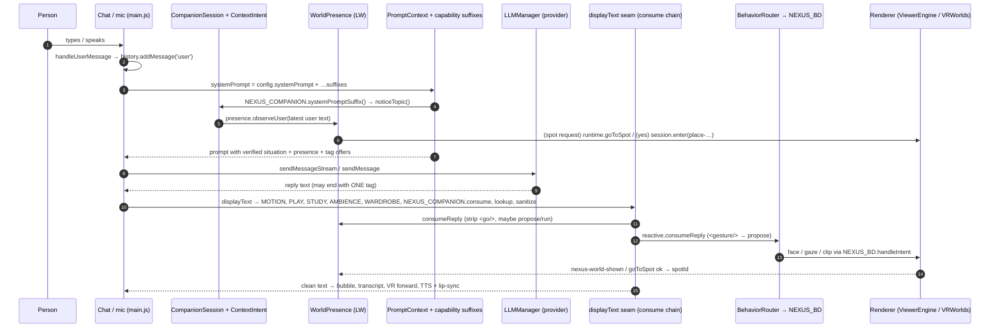
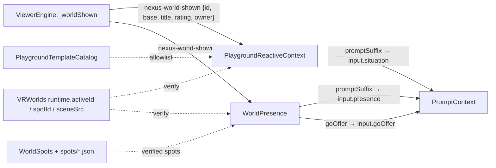
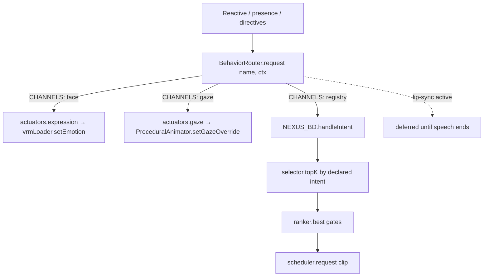

# NEXUS AI architecture — how a turn becomes behaviour

**Version:** 1.0, 2026-11-07.

**Audited at:** `feat/living-worlds-spatial-storytelling` after `388e8ed` (LW1–LW5).

**Status legend:**

- **Implemented**: the code exists and is exercised by tests or the browser.
- **Partial**: the code exists but has a known gap.
- **Proposed**: a design only; no code exists.

Every path, function and event below was read in the source at that commit. Where a
document elsewhere disagrees with the code, the code wins; please fix the document.

## 1. The lifecycle in one picture

The same turn has two halves. **Before the model**, the person's words and the
verified world state shape the prompt, and the person's own words may already
move you (a spot change starts here). **After the model**, her reply is
filtered once at the `displayText` seam. Tags come out, and each one is a
*proposal* that a trusted module checks before anything happens.

## 2. Initialisation (implemented)

| Step | Where | What |
| --- | --- | --- |
| Page shell | `index.html` | classic scripts, the `importmap` (`three` → `vendor/three-0.147.0`), and `src/engine-bridge.js` as a module |
| Renderer | `src/gltf-viewer/ViewerEngine.js` (ES module) | scene, camera, `CameraPresets`, `VRWorlds` runtime (`this.vrWorlds`), `AvatarManager`; `window.NEXUS_VIEWER` |
| Side-effect modules imported by the engine | `ViewerEngine.js` imports | `XRBackground.js`, `WorldSpots.js`, `VRWorlds.js` and others (IIFEs that publish `window.NEXUS_*`) |
| Feature modules | `src/behavior/boot.js` ordered list | IIFEs for features, companion, experiences, playgrounds, `WorldPresence`; order matters |
| Behavior Director | `boot.js` (`director` object) | registry, selector, ranker, scheduler, adapters; `window.NEXUS_BD`; `bus.on('intent', director.handleIntent)` |
| Companion facade | `src/companion/index.js` `attach()` | builds `live = { session, memory, privacy, director, scene, bridge, bar, marks, panel, registry, behavior }`, then `picker`, `reactive`, `presence`; `window.__NEXUS_COMPANION_LIVE`, `window.NEXUS_EXPERIENCE_RUNTIME` |
| Chat | `src/main.js` | `_surface()` (`NEXUS_CONVERSATION_SURFACE`), `handleUserMessage`, `speakText`, `addMessageToHistory` |

The wardrobe modules (`src/wardrobe/`) and the Quest voice scripts are loaded by
tags at the end of `index.html`, not by `boot.js`. `CLAUDE.md` explains why.

## 3. AI providers and model calls (implemented)

- `src/LLMManager.js`, `class LLMManager`:
  - `sendMessage(userMessage, systemPrompt, history, options)` covers NONE,
    OPENAI, CLAUDE, WATSONX, OLLAMA and OLLABRIDGE.
  - `sendMessageStream(..., onToken)` covers OPENAI, CLAUDE and OLLAMA.
- `main.js handleUserMessage(text)`:
  - It streams only when `_nexusLLM.sendMessageStream` exists and the
    provider is not `none`, `ollabridge` or `watsonx`. **OllaBridge is
    non-streaming**: `_handleNonStreamingResponse` → `callLLM`.
- There are three prompt assembly sites, and a new capability must join all
  three (`CLAUDE.md`):
  - `_handleStreamingResponse`
  - `callLLM`
  - `__nexusMediaSuffix`

  Each concatenates `config.systemPrompt` with
  `NEXUS_MOTION`, `NEXUS_CURRENT_MEDIA`, `NEXUS_STUDY_PROMPT`, `NEXUS_LOOKUP`,
  `NEXUS_TOGETHER_CAPABILITY`, `NEXUS_SCENE_AMBIENCE_CAPABILITY`,
  `NEXUS_WARDROBE_TOOL` and **`NEXUS_COMPANION.systemPromptSuffix()`**. Living
  Worlds and the playgrounds ride inside the last one.
- **Failure text:** `_addErrorWithRetry` appends
  `NEXUS_CHAT_ERROR_TEXT.describe(error)`, one fixed sentence per failure kind
  (`src/features/chat/ChatErrorText.js`).

## 4. Life, Copilot and Experiences context (implemented)

- **The session:** `src/companion/CompanionSession.js` holds the destination
  (`life`, `copilot` or `experiences`), the activity, `source`, grants and the
  conversation id.
  - `enter(destination, activity, { source, silent })` emits
    `session:entered`; `end()` emits `session:ended`. Both go through
    `session.on(listener)`.
- **Topic detection:** `src/companion/ContextIntent.js` `classify(text)` is
  local, English and Italian, and never calls the model. It runs from
  `index.js noticeTopic()` at prompt time.
  - Since LW1 it never replaces a running `place-*` activity, whatever its
    source.
- **The prompt:** `src/companion/PromptContext.js` `suffix(input)`:
  - Copilot gets practical rules plus the presence line, with no
    relationship memory.
  - Life and Experiences get relationship style, approved memories,
    `situation` (PG3), `gestureOffer`, `presence` and `goOffer`
    (Living Worlds).
- **Together activities:** `src/features/together/activities/*.js`, entered
  via `contract.js handOff()`.
  - A deliberate tap is the person's own choice, so it may change the
    session.

## 5. How the world reaches the model as trusted context (implemented)

- **Verification:**
  - An event is believed only if the runtime agrees: `vrWorlds.activeId === detail.id`.
  - A chip counts only if the venue template lists it.
  - A spot counts only if `WorldSpots.normalize` kept it, measured on the
    scene file that is up.
- **Sanitising:** text is cleaned of `<>{}[]` and bounded:
  - `situation`: 720 characters
  - `presence`: 1100 characters
- **Tag offers:** they are the one place a tag appears in the prompt, and they
  are accepted only in an exact generated shape:
  - `PromptContext` `GESTURE_OFFER`
  - `PromptContext` `GO_OFFER`
- **Reactive events:**
  - `nexus-playground-action` (router chips)
  - `nexus-playground-object` (object picker)
  - `interaction:completed` (`ExperienceDirector`)
  - `nexus-world-shown`

## 6. Model directives: parse, strip, validate (implemented)

All tags are stripped at the `displayText` seam in both handlers, so the
bubble, transcript, VR forward and TTS all get the clean text. Rules:

- at most one directive is acted on per reply
- a tag the person typed is never read, because only replies pass this seam
- the enabling switch is re-checked when the tag runs

| Tag | Owner | Runs when |
| --- | --- | --- |
| `<play …>` | `NEXUS_PLAY_DIRECTIVE` | Together media capability is on |
| study tags | `NEXUS_STUDY_DIRECTIVE` | study capability is on |
| ambience | `NEXUS_SCENE_AMBIENCE_DIRECTIVE` | ambience switch is on |
| `<wardrobe …/>` | `NEXUS_WARDROBE_TOOL` | Try-On rules (`CLAUDE.md`) |
| `<gesture intent target/>` | `PlaygroundReactiveContext.consumeReply` → `propose` | allowlisted intent; anchor targets only; not Copilot or private; dance only via the venue chip |
| `<go spot/>` | `WorldPresence.consumeReply` | the person asked to move this turn, or it becomes an offer their next yes takes |
| `<go place/>` | `WorldPresence.consumeReply` | opens a proposal only; the person's next-turn yes commits |
| `<activity name/>` | `ActivityDirective.consume` | not in a place; in a place relax/focus/story → `inPlace` mood; seaside/end refused |

While streaming, `main.js` masks partial tags through `NEXUS_MOTION.maskStreaming`
and `NEXUS_PLAYGROUND_REACTIVE.maskStreaming`, which covers `<gesture` and `<go`.

## 7. Behaviour selection (implemented, with a known gap)

- **The router:** `src/companion/BehaviorRouter.js` `request(name, context)`
  validates the name against `INTENTS` and routes through `CHANNELS`:
  - `smile` → face `happy`
  - `look_at_user` and `look_at_object` → gaze
  - `listen` → `nod_along`
  - `greet` → `greeting`
  - `relax` → `idle`
- **Unrouted intent:** `gesture_toward_object` is routed nowhere, because the
  only `point` clip is the arm-waving one.
- **Deferral:** while lip-sync runs, requests wait.
- **The director:** `NEXUS_BD.handleIntent(intent)` in `boot.js` does
  `selector.topK` → `ranker.best` (consent and mode gates) →
  `scheduler.request(clip)`.
  - **An undeclared intent ranks the whole library lexically.** That is why
    PG3 added `CHANNELS`. New behaviours must use declared intents (see
    `HOW_TO_ADD_COMPANION_BEHAVIORS.md`).
- **The registry:** `kb/animations.manifest.jsonl` holds 166 clips with
  `intents`, loaded by `src/behavior/registry/AnimationRegistry.js`.

## 8. Animation, expression, gaze, speech and lip-sync (implemented)

| Concern | Owner | Notes |
| --- | --- | --- |
| Body clips | Behavior Director scheduler → `NEXUS_CLIP_LOADER` / mixer layers (`src/behavior/mixer/`) | one full-body owner at a time; a playground dance chip owns the body while it runs |
| Procedural idle, breathing, gaze | `ProceduralAnimator` (`setGazeOverride`) | writes raw bones; `autoUpdateHumanBones` stays false |
| Expressions | `vrmLoader.setEmotion(name, intensity)`; `BehaviorEngine` emotion | PG3 actuators are timed and token-guarded |
| Speech | `main.js speakText()` → `TTSProvider` (stored vs active engine) or Web Speech | VR panel speaks via `js/speech-service.js` |
| Lip-sync | `NEXUS_LIP_SYNC.start(text, rate)` / remote level drive | body requests defer while it runs |
| Pose in VR | `VRPoseSystem.claimBones()` / `releaseBones()` | snapshot and restore |

## 9. How actions report success or failure (implemented)

| Action | Confirmation |
| --- | --- |
| World shown | `ViewerEngine._worldShown` → `nexus-world-shown`; `vrWorlds.activeId` |
| Spot move (LW3) | `runtime.goToSpot` resolves `{ ok, spot }`, and `runtime.spotId === spot` → `nexus-world-spot`; failure → `{ ok:false, why }` (`stale`, `no-scene`, …) |
| Mood (PG1) | `runtime.setMood` returns true or false |
| Behaviour | `BehaviorRouter.request` → `{ ok, applied: 'behavior' \| 'fallback' \| 'deferred' \| 'none', channel }` ('none' = unknown intent); only `behavior` is described to the model |
| Experience (Seaside) | `ExperienceDirector` emits `experience:started`, `failed`, `stopped`, `completed`, and `interaction:completed` |
| Chip | router `nexus-playground-action` `{ phase: selected \| started \| stopped \| completed \| failed }` |
| Trip (LW5) | arrival only on `nexus-world-shown` for the destination; 45 s timeout → back |

## 10. Memory and session state (implemented)

- **Memory:** `src/companion/MemoryScopes.js` keeps scopes for `life` and
  `copilot`.
  - `addMemory(scope, item)` refuses unless `item.approved === true`.
- **Clearing:** `src/features/chat/ConversationReset.js` is the single owner
  of forgetting.
  - `KEYS` lists what it erases and `KEPT` what it deliberately leaves.
  - `currentEpoch()` and `isCurrent(token)` let a reply that outlives Clear
    write nothing.
  - `onReset(listener)` is how in-memory state (`WorldPresence`) forgets.
- **Transient state:** shared moments, proposals, moods and spot notes are
  in-memory and per conversation; no storage.

## 11. Private versus general isolation (implemented)

- **The gate:** `src/companion/PrivacyGate.js` `allows(destination, scope, grants)`.
  Copilot never receives Life relationship text.
- **Private rooms** are worlds rated `private`, shown only on a
  `nexus-world-request` from owner `intimate`, after `adult.enter()`.
  - `VRWorlds.chooseWorld`, `placesFor` and the `?vrWorld=` preview refuse
    them otherwise (`tests/vr-places.test.js`).
- **The reactive context:** private reactions need `privateOpenNow()`, which
  is re-checked each step.
- **Presence:** `WorldPresence` gives private worlds nothing (no prompt, no
  offer, tags ignored), never travels to them, and gives Copilot no romantic
  spots and no trips.
- **The behaviour gates:** the adult tier is gated three times in the
  Behavior Director's ranker (`adult.available`, consent and attestation).

## 12. Cancellation when a world changes (implemented)

| Layer | Mechanism |
| --- | --- |
| VRWorlds runtime | `generation` on `show()`, `hide()` and `leave()`; `spotGen` on `goToSpot`; a stale load or move is dropped |
| PlaygroundReactiveContext | generation per verified world; queued reactions and late clip answers dropped |
| WorldPresence | `worldGen` on every `nexus-world-shown`; a move resolving after a world change is not committed; proposals cancelled on a world change, Clear, End or expiry |
| Chat turn | `ConversationReset` epoch |

## 13. Who owns what

| Subsystem | Owner (single writer) |
| --- | --- |
| Which world is shown | `ViewerEngine._applyVRWorld` following `CompanionSession` and the setting |
| Scene transform inside a world | `VRWorlds` runtime (`show`, `goToSpot`) |
| Camera on screens | `ViewerEngine` + `CameraPresets` (`fullBody`, `mid`, `bust`, `face`); never in XR |
| Where you are (logical) | `WorldPresence` |
| Body clip | Behavior Director scheduler / playground router for venue clips |
| Face and gaze | BehaviorRouter actuators |
| Speech | `TTSProvider` / `speakText` / `VoiceTurnController` (remote) |
| Prompt context | `PromptContext` (plus capability suffixes) |
| Forgetting | `ConversationReset` |

## 14. Implemented vs proposed

- **Implemented:** everything above, unless marked otherwise.
- **Partial:**
  - `gesture_toward_object` has no clip.
  - Spots exist for two scenes only.
  - No spot menu UI yet.
- **Proposed** (see `NEXUS_WORLD_ENGINE_DESIGN.md`):
  - a unified world manifest
  - room graphs and walking
  - object affordances with real actuators
  - story manifests
  - multi-agent support
