# NEXUS world asset pipeline — from a 3D model to a verified place

**Version:** 1.0, 2026-11-07. Every command below exists in this repository and
was run on this branch.

**Steps marked _proposed_ have no tool yet.** Do them by hand, or build the
tool first.

```mermaid
flowchart LR
  A[1 Source a licensed GLB] --> B[2 Review quality + licence]
  B --> C[3 Inspect hierarchy + names]
  C --> D[4 Cut by recipe<br/>subset-scene.mjs]
  D --> E[5 Measure triangles<br/>budget 30k phone]
  E --> F[6 Light / sky / fog / audio<br/>worlds.json]
  F --> G[7 Variants per tier<br/>lightFor]
  G --> H[8 Preview<br/>render-place-previews.mjs]
  H --> I[9 Register<br/>worlds.json]
  I --> J[10 Measure spots<br/>measure-spots.mjs]
  J --> K[11 Validate<br/>npm run validate]
  K --> L[12 Provenance + hashes]
  L --> M[13 Real-scene walkthrough]
```



## 1. Source: reuse first

**Look in the repository before downloading anything:**

- `assets/vr-worlds/scenes/`: assembled CC0 scenes from 3dassets.dev,
  listed in `PROVENANCE.md`. Several are unused or only partly used. For
  example, `3dassets-cozy-home` is downloaded but no world uses it.
- `assets/vr-worlds/kits/`: CC0 kits:
  - Kenney Furniture (140 models, including kitchen and bathroom pieces),
    Nature and Fantasy Town
  - Quaternius Medieval, Stylized Nature and Sci-Fi
  - KayKit Forest
- `assets/vr-worlds/sources/`: uncut sources for recipes.
- `assets/vr-worlds/panoramas/`: Poly Haven CC0 HDRI-derived JPGs.

**If you must add an asset:**

- **glTF or GLB only.**
- **Licence: CC0 or another licence compatible with Apache-2.0**, with
  commercial use allowed. Record it in `PROVENANCE.md` *in the same commit*.
- Prefer a whole, art-directed scene over assembling a room from kit pieces.
  Use kits for fills and repairs.

## 2. Review

Load it in the app before anything else. `?vrWorld=<id>` previews a registered
world on the desktop.

**Reject:** heavy single meshes, textures over 1024 px for props, no clear floor,
and strangers or figures that would share the place with her.

## 3. Inspect the hierarchy

3dassets.dev scenes number their top-level nodes `000-…`. This dumps them
straight from the GLB's JSON chunk:

```bash
node -e "const b=require('fs').readFileSync('assets/vr-worlds/scenes/pixel-flat.glb');const n=b.readUInt32LE(12);const j=JSON.parse(b.slice(20,20+n));console.log([...new Set(j.nodes.map(x=>x.name).filter(x=>/^\d{3}-/.test(x)&&!x.includes('/')))].join('\n'))"
```

The apartment's list shows the kitchen, bathroom and bedroom furniture, a
balcony, pets, and **six `resident-*` figures plus a crib**, which the recipe
then removed.

## 4. Cut by recipe, never by hand

```bash
node tools/vr/subset-scene.mjs            # every recipe
node tools/vr/subset-scene.mjs home       # one
node tools/vr/subset-scene.mjs --check    # print triangles, write nothing
```

- **Recipes:** `tools/vr/playground-subsets.json`. Each output names:
  - `src`
  - `out`
  - `keep`: top-level index ranges
  - `drop`: name regexes applied after `keep`
  - `budget`: a triangle ceiling, enforced
- **How it runs:** three r147's GLTFLoader and GLTFExporter in headless
  Chromium. The first run caches the exporter in `tmp/three-0.147.0/`.
- **Output size:** the output is dequantized float, so it is larger on disk
  than its triangle count suggests.

The apartment recipe:

```json
"home": {
  "src": "assets/vr-worlds/scenes/pixel-flat.glb",
  "out": "assets/vr-worlds/scenes/pixel-flat-home.glb",
  "drop": ["-resident-", "-crib$", "-indoor-bicycle$"],
  "budget": 30000
}
```

It printed `28760 → 26468 triangles, 148 nodes (budget 30000)`.

## 5. Budgets

| Tier | Rule | Where enforced |
| --- | --- | --- |
| Phone | ≤ 30,000 triangles per world (`VRWorlds.MOBILE_TRIANGLES`) | `allowedOn`, `chooseWorld`, `tests/vr-worlds.test.js` |
| Desktop | about 150k target (the walled town is the documented exception) | review |
| VR | the same as desktop, plus comfort rules (`docs/VR_WORLDS.md`) | `comfortProblem` test |
| Textures | panoramas ≤ 4096 px; kit textures ≤ 1024 px | review |

Every world **declares measured `triangles`**, and a test enforces this. Copy
the number `subset-scene.mjs` printed. **Do not raise the phone cap.**

## 6. Look and sound (`worlds.json`)

| Field | What it does |
| --- | --- |
| `sky` `{top, horizon, bottom}` | gradient sky for stylized worlds |
| `panorama` `{4k, 2k}` | a photographic sky on a sphere |
| `yaw` | turns the panorama |
| `fog` `{color, near, far}` | snapshotted and restored |
| `light` `{sky, ground, hemi, key, keyIntensity, fill, fillIntensity, rim, rimIntensity, exposure}` | the existing lights retinted; no new lights or shadows |
| `ground` `{radius, color}` | a disc for prop worlds |

**Moods** (playgrounds) are presets in `PlaygroundMoodPresets`, applied by
`runtime.setMood`.

**Ambient audio:** `playAmbient` exists in the runtime. Scene journeys bring
their own loops, which are not in the repository (`CLAUDE.md`, MV1
correction).

## 7. Variants per tier

A heavy desktop world gets a light stand-in: a separate entry with
`lightFor: "<id>"`, `tiers: ["mobile"]` or `["mobile","vr"]`, and its own scene
file. Examples are `irish-pub-light` and `neon-discoteca-light`.

`VRWorlds.resolveFor` chooses per device. **A variant is a different model, so
it gets its own spots file** (`NEXUS_SPATIAL_COORDINATES.md` §4).

## 8. Preview picture

```bash
npm start                                         # app on :8080, another shell
node tools/vr/render-place-previews.mjs apartment
```

This writes `assets/vr-worlds/previews/<id>.webp`, 640×480 and at most 60 KB.
The tool refuses dark, flat or empty frames. `tests/place-previews.test.js`
checks size, format and the place count (14 today), and that no preview is
orphaned.

## 9. Register the place

Add the entry to `assets/vr-worlds/worlds.json`, for example
`docs/engine/templates/world.manifest.example.json`. The fields are validated
by `VRWorlds.validateCatalogue`:

- `id`, `title`, `note`, `tiers`, `triangles`, `scene` (or `props`)
- `light`, `sky`/`panorama`
- for a place: `place: true`, `rating` (`general`, `romantic` or `private`),
  `preview` and `category`

The arrival placement (`scene.at`/`turn`) should be **computed** from a
measured spot (step 10), not picked by eye:

```bash
node -e "const fs=require('fs'),vm=require('vm');const m={exports:{}};vm.runInNewContext(fs.readFileSync('src/gltf-viewer/WorldSpots.js','utf8'),{module:m,globalThis:{}});const W=m.exports;const f=W.normalize(JSON.parse(fs.readFileSync('assets/vr-worlds/spots/pixel-flat-home.json','utf8')));console.log(JSON.stringify(W.placementFor(f.spots.find(s=>s.id==='sofa'))))"
# → {"turn":80,"at":[0.12,-0.16,1.189]}
```

The `vm` wrapper is needed because plain `node` treats `src/` files as ES
modules, while Jest loads them as CommonJS.

## 10. Measure spots

1. Add the scene and its spots to `tools/vr/spot-targets.json`: `id`,
   `label {en, it}`, `room`, `near` regexes, `sees {en, it}`, `can`
   (`stand-near`, `look-at`) and `rating`.
2. Then run:

```bash
node tools/vr/measure-spots.mjs scenes/<file>.glb
```

This takes about 4–15 minutes per scene in this container. It writes
`assets/vr-worlds/spots/<file>.json`. Read the ✓/✗ lines: a ✗ is the truth,
not a bug to hide. See `NEXUS_SPATIAL_COORDINATES.md` §5 for what each check
means.

## 11. Validate

```bash
npx jest tests/living-worlds tests/vr-worlds.test.js tests/vr-places.test.js tests/place-previews.test.js tests/playgrounds.test.js
npm run validate
node scripts/behavior-parity-baseline.mjs --check
```

These check:

- every scene, prop, panorama and preview file exists
- triangles are declared and within the phone budget
- comfort holds for props
- spots: the SHA-256 matches the model, every verified spot has its margins,
  spacing holds, the arrival is a measured spot, and the targets and the
  measured file agree

## 12. Provenance and hashes

- **Provenance:** in `assets/vr-worlds/PROVENANCE.md`, record the source
  URL, author, licence, triangles, and for cut files the recipe and what was
  dropped and why.
- **Hashes:** the spots file stores the model's SHA-256, and the spots test
  re-hashes it.
- **Wardrobe packs:** these have their own hash check
  (`npm run wardrobe:check`).

## 13. Walk it in the real app

Tests cannot see walls. Drive the real page in headless Chromium:

- enter the place: `__NEXUS_COMPANION_LIVE.session.enter('experiences','place-<id>',{source:'together',silent:true})`
- move with `__NEXUS_COMPANION_LIVE.presence.observeUser('andiamo in cucina')`
  or `presence.go('<spot>')`
- wait for `NEXUS_VIEWER.vrWorlds.spotId === '<spot>'`
- screenshot each spot

The LW3 walkthrough found four bad spots this way that every unit test had
passed. Its picture is `docs/images/living-worlds/apartment-spots.jpg`.

**Then the hardware:**

- a real phone
- a Quest in its own browser
- Quest Link (`docs/VR_STARTUP.md`)

**Never** report headset frame rates you did not measure on a headset.
