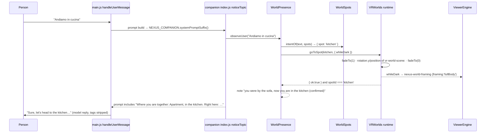

# Tutorial A — the premium apartment (how it was actually built)

This tutorial is a **record of what was done** on this branch (commits `644329c`,
`c527484`, `f224c4a`), written so you can repeat it on another place.

## 1. Inspect

The repository already had `assets/vr-worlds/scenes/pixel-flat.glb`: a CC0
one-bedroom flat of 28,760 triangles, used only as the phone bedroom.
Dumping its top-level names (pipeline §3) showed:

- **Rooms and furniture:** kitchen (`079-kitchen-island-with-stools`), dining
  table, living room (two sofas, TV, record player, guitar), bedroom
  (`118-double-bed`), desk, bathroom (bath, shower, basin) and balcony
- **Pets:** a cat and a dog
- **Problems:** six `resident-*` figures, a `128-crib` and a
  `117-indoor-bicycle`

The desktop bedroom (`bedroom-flat.glb`) was inspected separately. It is a
different model with no kitchen or bathroom.

## 2. Optimise by recipe

The recipe went into `tools/vr/playground-subsets.json`:

```json
"home": { "src": "assets/vr-worlds/scenes/pixel-flat.glb", "out": "assets/vr-worlds/scenes/pixel-flat-home.glb",
          "drop": ["-resident-", "-crib$", "-indoor-bicycle$"], "budget": 30000 }
```

```bash
node tools/vr/subset-scene.mjs home
# home: … 28760 → 26468 triangles, 148 nodes  (budget 30000)
```

**Why each drop:**

- **Strangers:** a shared flat for two must not have strangers in the bed.
- **The bike:** found later by the walkthrough, in the foreground of every
  kitchen view.

## 3. Register

`apartment` was added to `assets/vr-worlds/worlds.json`:

- `tiers: ["mobile","desktop","vr"]`
- `triangles: 26468`
- `rating: "romantic"`
- `preview: "previews/apartment.webp"`

`bedroom-light` was switched to the same file. **Its coordinates did not
change**: only nodes were dropped, so it is the same geometry.

## 4. Measure

Ten spots were authored in `tools/vr/spot-targets.json`: eight for the
apartment and four for the desktop bedroom. Each spot names a top-level node:
`^090-sofa-three-seat$`, `^079-kitchen-island-with-stools$`, and so on.

```bash
node tools/vr/measure-spots.mjs
```

The tool improved over three runs:

| Version | Change | Result |
| --- | --- | --- |
| v1 | open view of 2.2 m only | 8 + 4 "verified" spots, but on screen four of six were behind walls or a bike, or half inside a wall |
| v2–v3 | camera sightlines from 4.7 m; `mid` and `bust` framing | bad spots rejected; bed and balcony need closer framing |
| v4 | double-sided body checks; drawn-materials sightlines; full-width rays | all 8 apartment spots verified; the desktop bedroom keeps only `dressing-table` (its old "sofa" spot was *inside* `007-flat-wall-4m`) |

**The arrival** was computed from the measured sofa spot:
`placementFor(sofa)` gives `turn 80, at [0.12, -0.16, 1.189]`. That went into
the entry's `scene`, and a test asserts the arrival is the sofa.

**The preview:** `node tools/vr/render-place-previews.mjs apartment`.

## 5. Ground the words

The sofa's `sees` was first "the sofa, the TV and the record player". In a
real-model run she said "there's a blanket on the sofa". A raycast check found
`102-throw-blanket` 0.81 m from the sofa spot, at seat height. That made it
true, so `sees` now names it. **Fix the data, then let the model speak from it.**

## 6. From "Andiamo in cucina" to a confirmed spot



**Measured in the real app:** each move takes 0.8–1.2 s, with one world load
for eight moves. With a real model (OllaBridge `free-best`, Italian):

1. kitchen
2. sofa, through her suggestion and the person's "si mi piace"
3. bed
4. then a pending discoteca, a "sì", and arrival

Two world loads in total. The full table is in
`docs/LIVING_WORLDS_IMPLEMENTATION_REPORT.md`.

## 7. Repeat it on another place

1. Inspect.
2. Cut by recipe.
3. Register.
4. Author spot targets.
5. Measure, and accept the ✗ results.
6. Compute the arrival.
7. Render the preview.
8. Ground `sees`.
9. Walk it with a real model.
10. Commit with provenance.
