# Natural-language pose and animation control: acceptance (NL)

Batch `NL1`–`NL8`. Branch `claude/busy-hamilton-m2vq2f`, from `ultimate` `8082bb1`.

The report this answers:

> USER: Please change your position to On all fours.
> HER: Getting on all fours for you now, exactly how you asked.
> (the avatar is still standing)

**Verdict.** A position or an animation asked for in words now reaches her body through one
path on every surface, and the reply is told what her body did, from the rendered skeleton,
before it is asked for. In the real browser: en 37/37, it 18/18, phone 6/6, vr 7/7, switch 5/5 steps passed, no page errors. Not tested here: a real language
model's wording, real microphone audio, and a real headset. Details in
[What was not tested](#what-was-not-tested).

## 1. Root cause

Reproduced at the parser, before any fix (`tests/behavior/private-actions.test.js`, the four
`NL1` tests fail when the fix is taken out):

1. **The request was never a request.** `PrivateActionIntent.bodyFrom` matched a position's
   words only at the very start of the message (`^…`). "Please change your position to" in
   front of them meant `parse()` returned `null`: no action, no gate consulted, no pose
   controller called, nothing applied.
2. **Nothing told the model that nothing had moved.** With no action there was no line in
   `promptLines()` about her body, so the model answered the way the sentence invited:
   "Getting on all fours for you now."
3. **Even a recognised position could be claimed early.** `request()` is asynchronous and is
   never awaited (`TogetherCapability._askActions`), and `promptLines()` had no branch for a
   position still `pending`: a reply built in that window fell through to an unrelated line.
4. **Outside Private there was no path at all.** The motion fast path knows a few clips
   ("sit down", "dance"); Pose Studio's presets could only be picked in the panel; a clip
   could only be asked for by one of the fast path's words. Any other sentence went to the
   model alone.
5. **VR voice never reached the motion stack.** `VRChatIntegration.handleUserMessage` has its
   own message path, which called neither the fast path nor anything else that moves her, and
   its prompt carried nothing about her body.

None of this was in the pose controller, the skeleton, the renderer or the reply text. The
fix is in the pipeline between the sentence and the controller, and in what the reply is
told. No reply text was changed anywhere.

## 2. Architecture

```
typed text ─┐
desktop mic ─┼─ handleUserMessage ─┐
companion ───┘                     ├─ NEXUS_MOTION.onUserUtterance(text)      one entry
VR voice ── VRChatIntegration ─────┘            │
                                                ▼
                         NEXUS_POSE_COMMANDS  (src/xr/PoseCommands.js)        resolver
                         resolve()      ← NEXUS_POSE_STUDIO_PANEL.catalogue() ∩ vrPoseSystem.getPresetList()
                         resolveClip()  ← NEXUS_MOTION_CLIPS.registry()  (manifest + addon packs)
                                                │
                    ┌───────────────────────────┼───────────────────────────┐
                    ▼                           ▼                           ▼
        NEXUS_BODY_POSES               playAnimation('clip:<path>')    fast path (unchanged)
        (src/xr/BodyPoseService.js)    → MotionClipMap.play            sit / stand / dance / wave …
        lifecycle, request id                  │
                    ▼                           ▼
        NEXUS_PRIVATE_POSES            NEXUS_CLIP_LOADER
        (PrivatePoseController)        player state + rendered bones
        enter pose mode, claimBones,
        applyPreset, confirm()
                    │
                    ▼
        vrPoseSystem → skeleton → renderer
                    │
                    ▼  measured: getVisualBone('hips' | 'head' | feet | hands)
        status line ("Changing pose…" → "Pose applied.")   +   YOUR BODY, RIGHT NOW fact in the prompt
```

Pose Studio's own buttons call `vrPoseSystem.applyPreset` as before; the chat path enters pose
mode exactly as the panel does and applies through the same pose system, so there is one pose
engine. Private keeps its bridge, policy and gate (`PrivateActionBridge`), now reading the
same resolver; while a Private session runs, the ordinary-chat service stands aside.

### Lifecycle (P5)

`NEXUS_BODY_POSES.request()` moves a request through:

| State | Reached when |
| --- | --- |
| `requested` | the sentence resolved to a position (or to "unknown" / "ambiguous") |
| `validated` | the preset is in this session's catalogue and the pose system exists |
| `started` | pose mode entered, skeleton claimed, preset handed to the pose system |
| `applied` | the pose system reports that preset as current |
| `confirmed` | it has stopped blending; the **rendered** hips and trunk show that kind of position; 0.5 s later she is still held, in it, hips within 5 cm |
| `failed` | not rendered, not held, not applied, unknown, ambiguous, no pose system |
| `blocked` | Private owns her body |
| `cancelled` | superseded by a newer request, the avatar changed, the session ended |

`confirmed` also requires that the skeleton the pose system holds is the one being drawn
(`vrPoseSystem.avatarRoot === NEXUS_VIEWER.avatarManager.currentRoot`). A load that swaps the
avatar without rebinding the pose system would otherwise be "kneeling, confirmed" over an
avatar standing on screen; that was measured during this work and is now a failure.

Each request carries `id`, `avatarId` (the skeleton it was made for) and `sessionId`. A
cancelled request can report nothing afterwards. A failed one puts her back in the position
she held before (or lets her stand) and says so.

For animations: the clip map's answer, then the player (`getCurrentPlaybackState().clip` is
the file asked for) **and** her rendered hands, head and hips moving more than 4 mm across up
to three 600 ms windows. A clip the player reports while nothing on screen moves is a
failure.

### What the reply is told

`handleUserMessage` and the VR path await `NEXUS_MOTION.whenBodySettled(3000)` (and Private's
`whenPoseSettled`) before building the prompt, so the fact is normally final:

| Her body | The line the model is given |
| --- | --- |
| still moving at the 3 s limit | "…you are moving into it right now; it is not confirmed on screen yet. … Do not say it is done." |
| confirmed | "Your body is in the position they asked for ("Kneeling"), confirmed on screen." |
| failed | "You tried to take the position … and it did not show on your body: you are still as you were. Say plainly that you could not; never say you are in it." |
| nobody has that position | "They asked for a position your body cannot take here … Say plainly that you can't take that one; never say you are in it." |
| two presets answer | "…could be more than one of yours (Standing Relaxed / Lying Relaxed). You have not moved. Ask which one." |
| animation missing | "They asked for an animation "…" that isn't available for this character. Nothing played." |
| animation switched off | "…which is switched off for this character. Nothing played." |

The status line under the header says the same in the app's language: "Changing pose…" →
"Pose applied." / "I couldn't apply that pose." / "That animation isn't available for this
character."

## 3. Dynamic discovery

Nothing lists poses or clips a second time.

- **Positions.** The vocabulary is `NEXUS_POSE_STUDIO_PANEL.catalogue()` (the navigator's
  list, filtered the way the panel filters it) intersected with
  `vrPoseSystem.getPresetList()`. A preset answers to its label, its label with its category
  ("sitting crossed"), its name in words, and the everyday phrases in `PoseCommands.LANG`.
  The phrases are words *for* a preset name; a phrase whose preset the session does not offer
  resolves to nothing, and a preset added to the navigator is reachable by its label with no
  change to the resolver (both are tests).
- **Animations.** `NEXUS_MOTION_CLIPS.registry()` is built from the loaded manifest's
  categories and the two addon packs, the same index the clip map plays from. Each entry
  carries `allowed` and why not (`quarantined`, `disabled` by the format or library setting,
  `load_failed`). The manifest's `emotionMapping` supplies mood names ("happy" →
  `emotion/joy.bvh`). In this build: 155 clips, 19 not allowed.
- **Languages (NL2).** One table per language (`LANG.en`, `LANG.it`), never mixed. The app's
  language (`AppLanguage.code`, then `app_lang`) picks the table: English is read in an
  English session and Italian in an Italian one. A language without a table falls back to
  English.

## 4. Supported categories

Positions reachable in ordinary chat (Pose Studio, Spicy mode off: 26 presets):
Presenter, Standing, Companion, Sitting, Kneeling, Lying, plus "stand up", "the previous
position" and "your normal standing position". Animations: every allowed clip in the
registry by name, moods from the manifest, the fast path's gestures, the clip map's gestures
by everyday words (clap, shrug, sing, jumping jacks), "repeat that", "the next one", "back to
idle".

### English examples (English session)

| Said | What happens |
| --- | --- |
| Kneel down. | `kneeling`, confirmed |
| Lie on your back. | `lyingBack`, confirmed |
| Go back to the previous position. | `kneeling`, confirmed |
| Stand up. | standing, confirmed |
| Go back to the previous position. | `kneeling`, confirmed |
| Sit with your legs crossed. | `sittingCrossed`, confirmed |
| Lie on your side. | `lyingSide`, confirmed |
| Bend forward. | `standingBendForward`, confirmed |
| Sit comfortably. | `sittingLegsUp`, confirmed |
| Return to your normal standing position. | standing, confirmed |
| get on your knees (spoken) | `kneeling`, confirmed |
| Please change your position to a handstand. | refused, body unchanged |
| Lean against the wall. | refused, body unchanged |
| Get into the relaxed pose. | refused, body unchanged |
| Dance for me. | fast path: dance |
| Stop dancing. | fast path: stop |
| Play the Rumba animation. | played, confirmed: dance_rumba.bvh |
| Play the next animation. | played, confirmed: dance_gangnam_style.vrma |
| Repeat that animation. | played, confirmed: dance_gangnam_style.vrma |
| Start the relaxing animation. | played, confirmed: Relax.vrma |
| Show me your happy animation. | played, confirmed: amusement.bvh |
| Clap your hands. | gesture played |
| Play the unicorn animation. | refused, body unchanged |
| Go back to idle. | fast path: stop |
| Wave goodbye. | fast path: wave |
| Spin around. | fast path: turn_around |
| Do a spin. | fast path: spin |
| Show me your outfit. | fast path: show_outfit |
| Do the peace sign. | fast path: peace_sign |
| Sit down. | fast path: sit |
| Stand up. | fast path: stand |
| Turn around. | fast path: turn_around |
| lie on your back (spoken) | `lyingBack`, confirmed |
| Dance for me. | fast path: dance |
| Stop. | fast path: stop |

### Italian examples (Italian session)

| Said | What happens |
| --- | --- |
| Inginocchiati. | `kneeling`, confirmed |
| Sdraiati sulla schiena. | `lyingBack`, confirmed |
| Torna alla posizione precedente. | `kneeling`, confirmed |
| Alzati. | standing, confirmed |
| Siediti a gambe incrociate. | `sittingCrossed`, confirmed |
| Sdraiati sul fianco. | `lyingSide`, confirmed |
| Piegati in avanti. | `standingBendForward`, confirmed |
| Kneel down. | not read as a request |
| Torna in piedi. | standing, confirmed |
| Siediti. | fast path: sit |
| Alzati. | fast path: stand |
| Girati. | fast path: turn_around |
| mettiti in ginocchio (spoken) | `kneeling`, confirmed |
| Cambia posizione, fai la verticale. | refused, body unchanged |
| Balla per me. | fast path: dance |
| Fermati. | fast path: stop |
| Batti le mani. | gesture played |
| Fai partire l'animazione unicorno. | refused, body unchanged |

### Eligibility controls, unchanged

- Presets Pose Studio marks `adult` have **no phrases** in the resolver and are **not matched
  by label** there, even when the catalogue lists them (test: "an adult preset is never
  matched…"). In ordinary chat they are unreachable. In Private they keep exactly the words,
  the consent level and the gate they had (`PrivateActionIntent.POSE_WORDS`,
  `PrivateActionPolicy`, `ADULT_POSES`): the fix makes the reported sentence reach that same
  gate, and below the level the same sentence is still `blocked / pace` (test: "the lead-in
  opens no gate").
- Consequently "Get down on your hands and knees." and "Lean against the wall." resolve to an
  honest "I can't take that position" in ordinary chat: `handsKnees` and `wallLean` are
  adult-flagged presets and no new vocabulary was added for them. `handsKnees` and
  `allFoursArched` stay distinct: Private's existing key maps to `handsKnees` only.
- The motion switch (`MotionPolicy.isEnabled`), the movement tiers, the clip quarantine, the
  BVH and built-in-library settings all apply to named clips as to any other.
- No consent state is read, moved or created by any of this.

## 5. Browser evidence

`node tools/qa/natural-language-motion-acceptance.mjs` (`npm run audit:nl-motion`), headless
Chromium with SwiftShader, the avatar the page loads itself (the default library avatar). Every sentence is
typed into the real chat box and sent with the real Send button unless marked otherwise.
Measurements are of the rendered skeleton; the "told the reply" column summarises the `YOUR
BODY, RIGHT NOW` line of the system prompt the reply was requested with. Fast-path motions
(dance, wave, sit…) add no such line: the motion contract's own world state reports them, as
it did before this change. "moved m" is how far her hands, head or hips travelled in 600 ms
at the end of the step: 0 for a held position, more while a clip plays.

### English, desktop 1440×900

Standing reference: hips 0.894 m, trunk 2°. 37 of 37 steps passed; page errors: 0.

| # | via | said | result | lifecycle | hips m | trunk ° | moved m | status line | told the reply |
| --- | --- | --- | --- | --- | --- | --- | --- | --- | --- |
| 01 | typed | Kneel down. | `kneeling`, confirmed | requested → validated → started → applied → confirmed | 0.469 | 5 | 0 | changing → applied | position confirmed on screen |
| 02 | wait | (wait 6 s) | still held |  | 0.469 | 5 | 0 |  | (no reply asked) |
| 03 | typed | Lie on your back. | `lyingBack`, confirmed | requested → validated → started → applied → confirmed | 0.101 | 91 | 0 | changing → applied | position confirmed on screen |
| 04 | typed | Go back to the previous position. | `kneeling`, confirmed | requested → validated → started → applied → confirmed | 0.469 | 5 | 0 | changing → applied | position confirmed on screen |
| 05 | typed | Stand up. | standing, confirmed | requested → validated → started → applied → confirmed | 0.889 | 13 | 0.122 | standing-up → stood | standing again |
| 06 | typed | Go back to the previous position. | `kneeling`, confirmed | requested → validated → started → applied → confirmed | 0.469 | 5 | 0 | changing → applied | position confirmed on screen |
| 07 | typed | Sit with your legs crossed. | `sittingCrossed`, confirmed | requested → validated → started → applied → confirmed | 0.567 | 5 | 0 | changing → applied | position confirmed on screen |
| 08 | typed | Lie on your side. | `lyingSide`, confirmed | requested → validated → started → applied → confirmed | 0.158 | 93 | 0 | changing → applied | position confirmed on screen |
| 09 | typed | Bend forward. | `standingBendForward`, confirmed | requested → validated → started → applied → confirmed | 0.859 | 57 | 0 | changing → applied | position confirmed on screen |
| 10 | typed | Sit comfortably. | `sittingLegsUp`, confirmed | requested → validated → started → applied → confirmed | 0.791 | 22 | 0 | changing → applied | position confirmed on screen |
| 11 | typed | Return to your normal standing position. | standing, confirmed | requested → validated → started → applied → confirmed | 0.895 | 4 | 0.006 | standing-up → stood | standing again |
| 12 | mic | get on your knees | `kneeling`, confirmed | requested → validated → started → applied → confirmed | 0.469 | 5 | 0 | changing → applied | position confirmed on screen |
| 13 | typed | Please change your position to a handstand. | refused, body unchanged |  | 0.469 | 5 | 0 | changing → unsupported | can't take that position |
| 14 | typed | Lean against the wall. | refused, body unchanged |  | 0.469 | 5 | 0 | changing → unsupported | can't take that position |
| 15 | typed | Get into the relaxed pose. | refused, body unchanged |  | 0.469 | 5 | 0 | changing → ambiguous | ask which one |
| 16 | typed | Dance for me. | fast path: dance |  | 0.714 | 23 | 0.715 |  | no NL line (motion contract as before) |
| 17 | typed | Stop dancing. | fast path: stop |  | 0.9 | 5 | 0.032 |  | no NL line (motion contract as before) |
| 18 | typed | Play the Rumba animation. | played, confirmed: dance_rumba.bvh |  | 0.899 | 4 | 0.332 | clip-starting → clip-playing | animation playing, confirmed |
| 19 | typed | Play the next animation. | played, confirmed: dance_gangnam_style.vrma |  | 0.816 | 20 | 0.233 | clip-starting → clip-playing | animation playing, confirmed |
| 20 | typed | Repeat that animation. | played, confirmed: dance_gangnam_style.vrma |  | 0.822 | 21 | 0.128 | clip-starting → clip-playing | animation playing, confirmed |
| 21 | typed | Start the relaxing animation. | played, confirmed: Relax.vrma |  | 0.874 | 6 | 0.106 | clip-starting → clip-playing | animation playing, confirmed |
| 22 | typed | Show me your happy animation. | played, confirmed: amusement.bvh |  | 0.891 | 1 | 0.022 | clip-starting → clip-playing | animation playing, confirmed |
| 23 | typed | Clap your hands. | gesture played |  | 0.864 | 3 | 0.533 | clip-starting → clip-playing | animation playing, confirmed |
| 24 | typed | Play the unicorn animation. | refused, body unchanged |  | 0.885 | 1 | 0.015 | clip-unavailable | animation isn't available |
| 25 | typed | Go back to idle. | fast path: stop |  | 0.893 | 8 | 0.025 |  | no NL line (motion contract as before) |
| 26 | typed | Wave goodbye. | fast path: wave |  | 0.908 | 5 | 0.013 |  | no NL line (motion contract as before) |
| 27 | typed | Spin around. | fast path: turn_around |  | 0.902 | 5 | 0.016 |  | no NL line (motion contract as before) |
| 28 | typed | Do a spin. | fast path: spin |  | 0.892 | 5 | 0.441 |  | no NL line (motion contract as before) |
| 29 | typed | Show me your outfit. | fast path: show_outfit |  | 0.867 | 1 | 0.244 |  | no NL line (motion contract as before) |
| 30 | typed | Do the peace sign. | fast path: peace_sign |  | 0.844 | 4 | 0.346 |  | no NL line (motion contract as before) |
| 31 | typed | Sit down. | fast path: sit |  | 0.529 | 8 | 0.028 |  | no NL line (motion contract as before) |
| 32 | typed | Stand up. | fast path: stand |  | 0.874 | 5 | 0.287 |  | no NL line (motion contract as before) |
| 33 | typed | Turn around. | fast path: turn_around |  | 0.894 | 11 | 0.129 |  | no NL line (motion contract as before) |
| 34 | mic | lie on your back | `lyingBack`, confirmed | requested → validated → started → applied → confirmed | 0.101 | 91 | 0 | changing → applied | position confirmed on screen |
| 35 | rapid | Kneel down. / Lie on your back. / Kneel down. | `kneeling`, confirmed | requested → validated → started → applied → confirmed | 0.469 | 5 | 0 | changing → changing → changing → applied | (no reply asked) |
| 36 | typed | Dance for me. | fast path: dance |  | 0.919 | 21 | 0.366 |  | no NL line (motion contract as before) |
| 37 | typed | Stop. | fast path: stop |  | 0.892 | 4 | 0.109 |  | no NL line (motion contract as before) |

After the session ended: held nothing, holding false, hips 0.894 m.

### Italian, desktop 1440×900

Standing reference: hips 0.894 m, trunk 2°. 18 of 18 steps passed; page errors: 0.

| # | via | said | result | lifecycle | hips m | trunk ° | moved m | status line | told the reply |
| --- | --- | --- | --- | --- | --- | --- | --- | --- | --- |
| 01 | typed | Inginocchiati. | `kneeling`, confirmed | requested → validated → started → applied → confirmed | 0.469 | 5 | 0 | changing → applied | position confirmed on screen |
| 02 | typed | Sdraiati sulla schiena. | `lyingBack`, confirmed | requested → validated → started → applied → confirmed | 0.101 | 91 | 0 | changing → applied | position confirmed on screen |
| 03 | typed | Torna alla posizione precedente. | `kneeling`, confirmed | requested → validated → started → applied → confirmed | 0.469 | 5 | 0 | changing → applied | position confirmed on screen |
| 04 | typed | Alzati. | standing, confirmed | requested → validated → started → applied → confirmed | 0.889 | 4 | 0.031 | standing-up → stood | standing again |
| 05 | typed | Siediti a gambe incrociate. | `sittingCrossed`, confirmed | requested → validated → started → applied → confirmed | 0.57 | 3 | 0 | changing → applied | position confirmed on screen |
| 06 | typed | Sdraiati sul fianco. | `lyingSide`, confirmed | requested → validated → started → applied → confirmed | 0.146 | 90 | 0 | changing → applied | position confirmed on screen |
| 07 | typed | Piegati in avanti. | `standingBendForward`, confirmed | requested → validated → started → applied → confirmed | 0.854 | 57 | 0 | changing → applied | position confirmed on screen |
| 08 | typed | Kneel down. | not read as a request |  | 0.854 | 57 | 0 |  | holding Bent Over |
| 09 | typed | Torna in piedi. | standing, confirmed | requested → validated → started → applied → confirmed | 0.896 | 6 | 0.007 | standing-up → stood | standing again |
| 10 | typed | Siediti. | fast path: sit |  | 0.529 | 12 | 0.016 |  | no NL line (motion contract as before) |
| 11 | typed | Alzati. | fast path: stand |  | 0.886 | 5 | 0.082 |  | no NL line (motion contract as before) |
| 12 | typed | Girati. | fast path: turn_around |  | 0.896 | 3 | 0.076 |  | no NL line (motion contract as before) |
| 13 | mic | mettiti in ginocchio | `kneeling`, confirmed | requested → validated → started → applied → confirmed | 0.469 | 5 | 0 | changing → applied | position confirmed on screen |
| 14 | typed | Cambia posizione, fai la verticale. | refused, body unchanged |  | 0.469 | 5 | 0 | changing → unsupported | can't take that position |
| 15 | typed | Balla per me. | fast path: dance |  | 0.846 | 15 | 0.358 |  | no NL line (motion contract as before) |
| 16 | typed | Fermati. | fast path: stop |  | 0.894 | 8 | 0.118 |  | no NL line (motion contract as before) |
| 17 | typed | Batti le mani. | gesture played |  | 0.864 | 3 | 0.538 | clip-starting → clip-playing | animation playing, confirmed |
| 18 | typed | Fai partire l'animazione unicorno. | refused, body unchanged |  | 0.894 | 4 | 0.005 | clip-unavailable | animation isn't available |

After the session ended: held nothing, holding false, hips 0.895 m.

### English, 390×844

Standing reference: hips 0.894 m, trunk 2°. 6 of 6 steps passed; page errors: 0.

| # | via | said | result | lifecycle | hips m | trunk ° | moved m | status line | told the reply |
| --- | --- | --- | --- | --- | --- | --- | --- | --- | --- |
| 01 | typed | Kneel down. | `kneeling`, confirmed | requested → validated → started → applied → confirmed | 0.469 | 5 | 0 | changing → applied | position confirmed on screen |
| 02 | typed | Lie on your back. | `lyingBack`, confirmed | requested → validated → started → applied → confirmed | 0.101 | 91 | 0 | changing → applied | position confirmed on screen |
| 03 | typed | Stand up. | standing, confirmed | requested → validated → started → applied → confirmed | 0.894 | 8 | 0.006 | standing-up → stood | standing again |
| 04 | typed | Play the Rumba animation. | played, confirmed: dance_rumba.bvh |  | 0.881 | 2 | 0.25 | clip-starting → clip-playing | animation playing, confirmed |
| 05 | typed | Play the unicorn animation. | refused, body unchanged |  | 0.872 | 13 | 0.251 | clip-unavailable | animation isn't available |
| 06 | typed | Go back to idle. | fast path: stop |  | 0.891 | 1 | 0.052 |  | no NL line (motion contract as before) |

After the session ended: held nothing, holding false, hips 0.892 m.

### English, emulated Quest 3 (IWER), voice transcripts

Session: `presenting: true`, IWER metaQuest3 (emulated), panel ready: true.

Standing reference: hips 0.894 m, trunk 3°. 7 of 7 steps passed; page errors: 0.

| # | via | said | result | lifecycle | hips m | trunk ° | moved m | status line | told the reply |
| --- | --- | --- | --- | --- | --- | --- | --- | --- | --- |
| 01 | vr | kneel down | `kneeling`, confirmed | requested → validated → started → applied → confirmed | 0.465 | 5 | 0 | changing → applied | position confirmed on screen |
| 02 | vr | lie on your back | `lyingBack`, confirmed | requested → validated → started → applied → confirmed | 0.096 | 91 | 0 | changing → applied | position confirmed on screen |
| 03 | vr | stand up | standing, confirmed | requested → validated → started → applied → confirmed | 0.892 | 12 | 0.031 | standing-up → stood | standing again |
| 04 | vr | change your position to a handstand | refused, body unchanged |  | 0.893 | 13 | 0.017 | changing → unsupported | can't take that position |
| 05 | vr | dance for me | fast path: dance |  | 0.912 | 15 | 0.345 |  | no NL line (motion contract as before) |
| 06 | vr | stop | fast path: stop |  | 0.894 | 6 | 0.109 |  | no NL line (motion contract as before) |
| 07 | vr | play the unicorn animation | refused, body unchanged |  | 0.884 | 4 | 0.057 | clip-unavailable | animation isn't available |

After the session ended: held nothing, holding false, hips 0.899 m.

### Another character picked while a position is landing (English, desktop)

Standing reference: hips 0.894 m, trunk 2°. 5 of 5 steps passed; page errors: 0.

| # | via | said | result | lifecycle | hips m | trunk ° | moved m | status line | told the reply |
| --- | --- | --- | --- | --- | --- | --- | --- | --- | --- |
| 01 | typed | Kneel down. | `kneeling`, confirmed | requested → validated → started → applied → confirmed | 0.469 | 5 | 0 | changing → applied | position confirmed on screen |
| 02 | typed | Stand up. | standing, confirmed | requested → validated → started → applied → confirmed | 0.882 | 2 | 0.009 | standing-up → stood | standing again |
| 03 | typed + avatar switch | Kneel down. | new character standing, nothing held, nothing claimed (old request: confirmed) | requested → validated → started → applied → confirmed | 0.874 | 2 | 0.022 | changing → applied | (no reply asked) |
| 04 | typed | Kneel down. | `kneeling`, confirmed | requested → validated → started → applied → confirmed | 0.601 | 3 | 0 | changing → applied | position confirmed on screen |
| 05 | typed | Stand up. | standing, confirmed | requested → validated → started → applied → confirmed | 0.878 | 6 | 0.01 | standing-up → stood | standing again |

After the session ended: held nothing, holding false, hips 0.878 m.

About the switch run: in the browser the position landed on the first character (step 03's
request reads `confirmed`, made for her and confirmed while she was still the one on screen)
and the second character then arrived standing, with nothing held and nothing told about a
position. A request that is still in flight when the new avatar arrives is `cancelled /
avatar-changed`; that timing did not occur in this run (the file takes longer to load than a
position takes to land) and is covered by Jest
(`tests/nl/body-pose-service.test.js`, "another avatar mid-transition").

### Frames

| run | step | said | frame |
| --- | --- | --- | --- |
| en | 00-start | (before anything was said) |  |
| en | 01-kneel | Kneel down. | 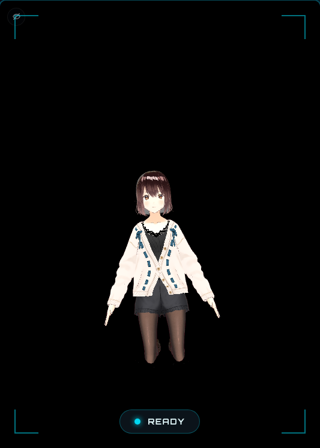 |
| en | 03-lie-on-back | Lie on your back. | 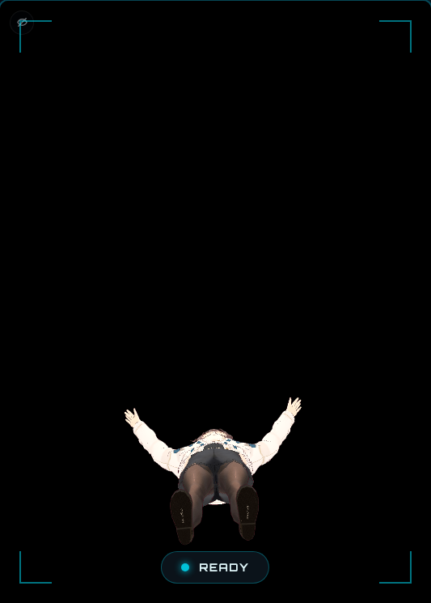 |
| en | 05-stand-up | Stand up. | 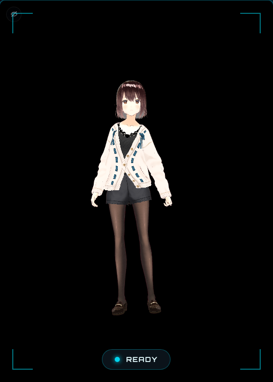 |
| en | 07-sit-crossed | Sit with your legs crossed. | 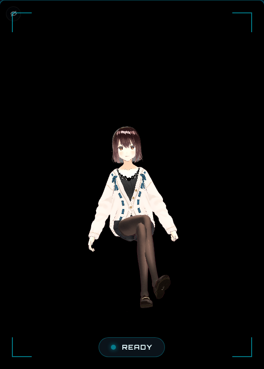 |
| en | 08-lie-on-side | Lie on your side. | 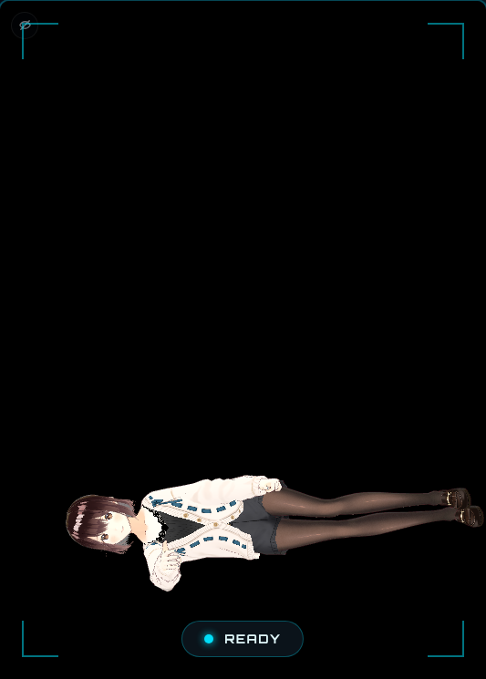 |
| en | 09-bend-forward | Bend forward. | 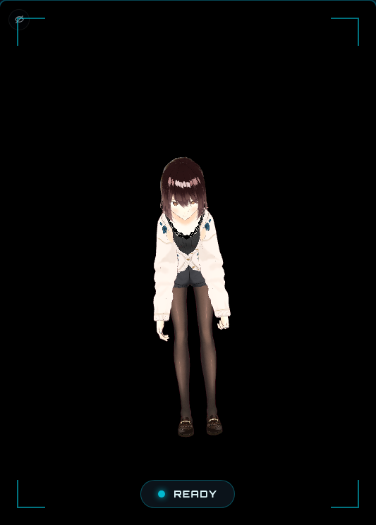 |
| it | 01-inginocchiati | Inginocchiati. |  |
| it | 02-sulla-schiena | Sdraiati sulla schiena. |  |
| it | 04-alzati | Alzati. | 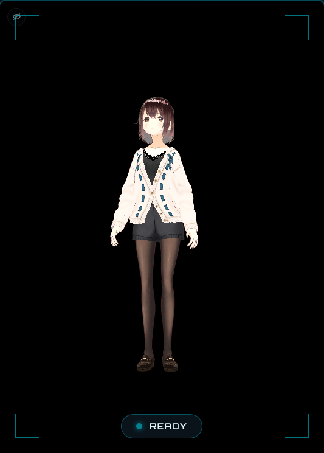 |
| it | 05-gambe-incrociate | Siediti a gambe incrociate. | 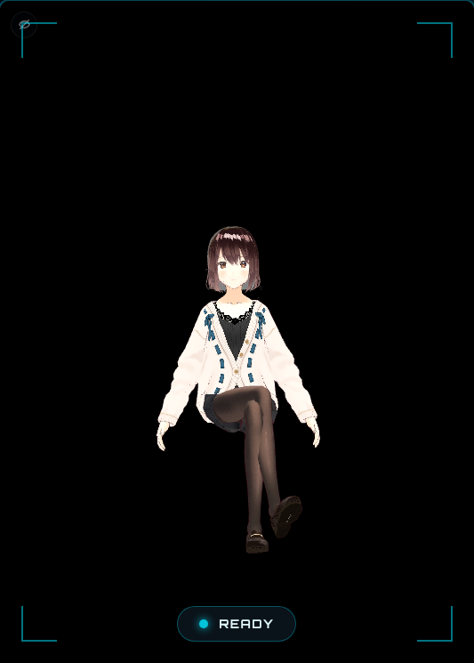 |
| vr | 00-start | (before anything was said) | 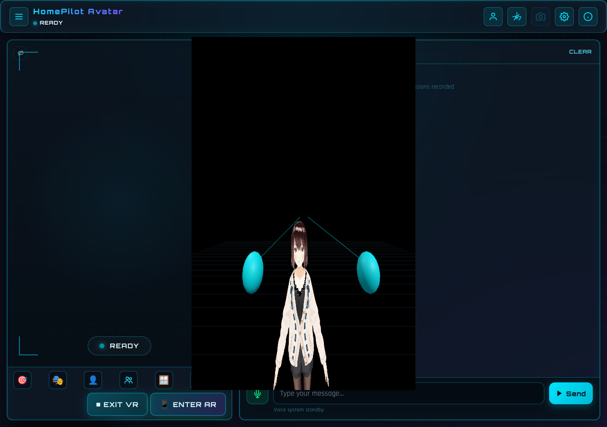 |
| vr | 01-vr-kneel | kneel down | 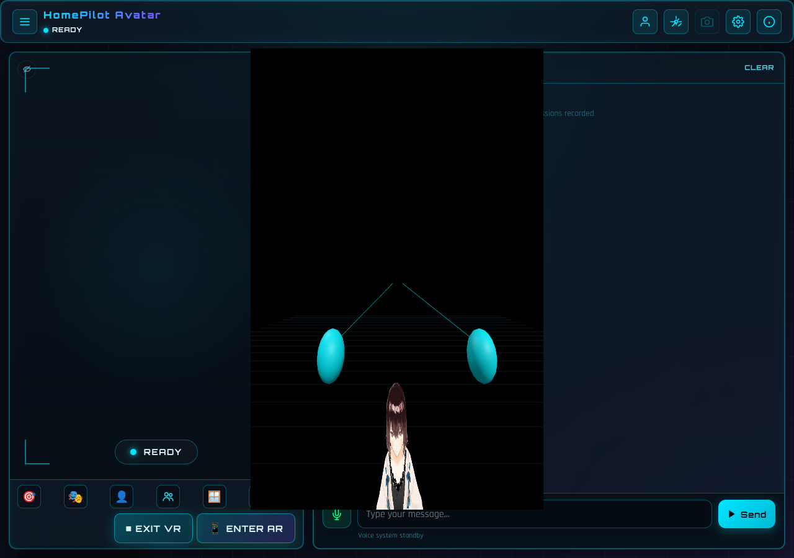 |
| vr | 03-vr-stand | stand up | 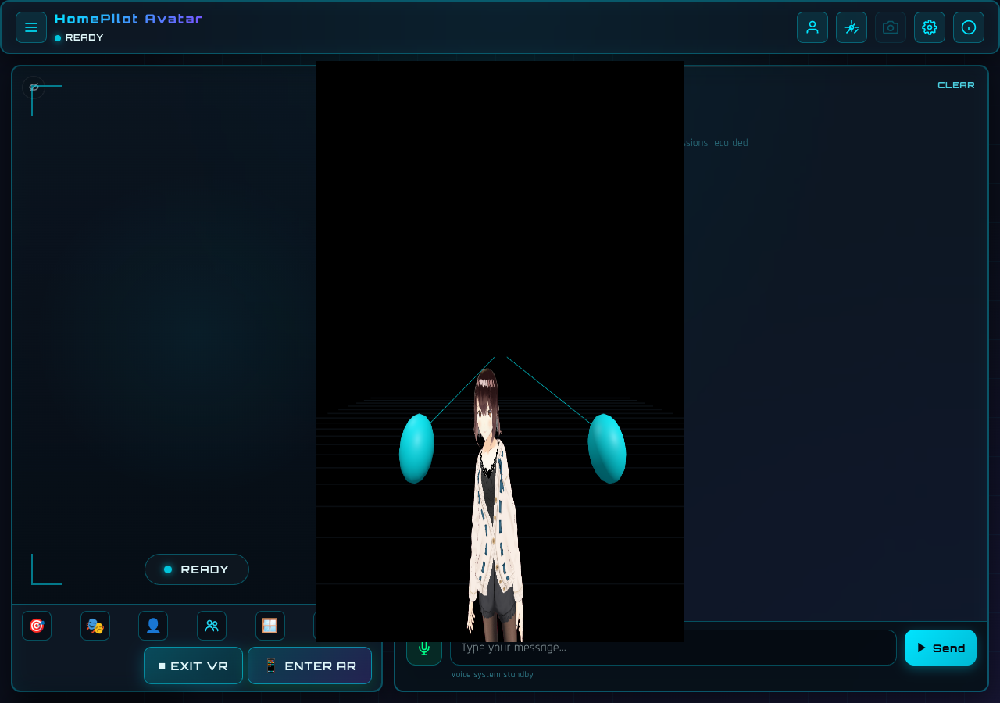 |
| switch | 03-switch-avatar | Kneel down. | 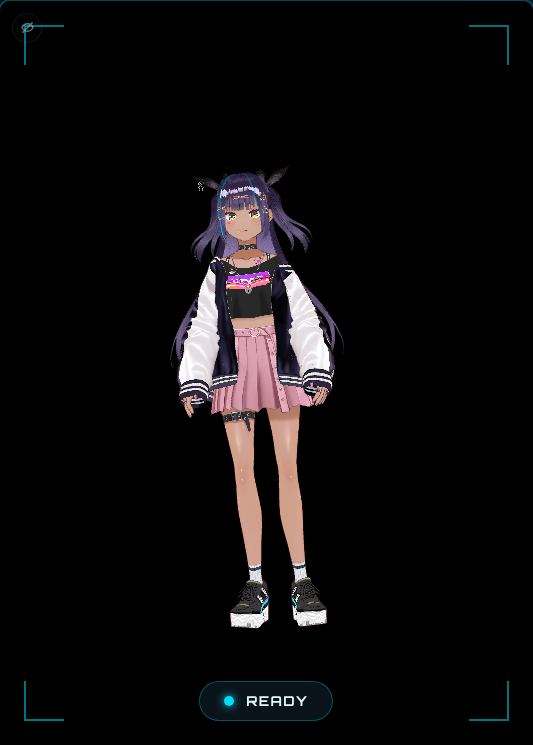 |
| switch | 04-kneel-new-avatar | Kneel down. | 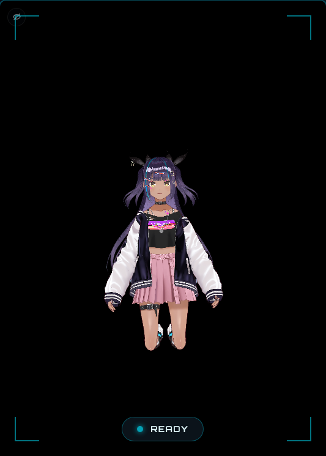 |

## 6. Desktop voice

`mic` rows above go through the real microphone button and the real `recognition.onresult`
handler, which auto-sends through `handleUserMessage`, the same function typed text uses. The
recognizer itself is a stand-in that hands the handler a transcript: a headless browser has
no audio. So the path from a transcript to her body is exercised; recognition accuracy is not.

## 7. VR

Emulated Meta Quest 3 (IWER 2.7.0, as `tools/vr/xr-entry-scenarios.mjs`): ENTER VR, then
transcripts handed to `vrChatIntegration.handleUserMessage`, the function the headset's
recognizer calls. Results are in the `vr` table above.

**Quest hardware: NOT TESTED.** No headset was available. Nothing here says how this looks,
performs or feels in a real Quest; the emulator implements the WebXR API only.

## 8. Automated tests

| Suite | Tests | Covers |
| --- | --- | --- |
| `tests/nl/pose-commands.test.js` | 62 | resolver per language, catalogue as vocabulary, adult exclusion, typos, ambiguity, clip registry, missing and switched-off clips |
| `tests/nl/body-pose-service.test.js` | 28 | lifecycle order, confirmation from rendered bones, not rendered / idle takes skeleton back / hold dropped, superseding, rapid A→B→A, previous, stand, avatar switch mid-transition, session end mid-transition, Private stands aside, prompt facts |
| `tests/nl/chat-motion.test.js` | 28 | typed and spoken-transcript paths, Italian vs English session, reply waits for the body, failure acknowledgment, held pose vs idle, animation over a pose, named / missing / switched-off / unloadable clips, repeat and next, every surface calls the one entry |
| `tests/behavior/private-actions.test.js` (`NL` tests) | 9 | the reported sentence (EN, IT), same gate below the level, pending vs done vs failed acknowledgment, unknown position, catalogue preset in Private |

Mutation checks run during development: removing the parser fix fails 4 tests; making
confirmation trust the pose system's word instead of the rendered skeleton fails 2.

`npm run validate`: exit 0: lint clean, format clean, 6,978 tests in 320 suites, all passing (2026-11-16, Node 24).

## 9. What was not tested

- **A language model's reply.** No provider is connected in this environment. The acceptance
  replaces `_nexusLLM` with a recorder and checks what the model is *told*. That the model
  then obeys the line is not shown here.
- **Real speech.** Transcripts were injected at the recognizer boundary.
- **Quest hardware.** Emulation only (section 7).
- **Adult-flagged presets.** Not asked for, not rendered and not screenshotted in this
  acceptance; their Private path is covered by Jest with a stand-in pose system only.
- **Other avatars.** AvatarSample_A in every run, and AvatarSample_B after the switch. All 26
  non-adult presets were applied once to AvatarSample_A through the lifecycle and all 26 were
  confirmed (hips 0.071–0.915 m against 0.894 m standing); that sweep is how the seated
  legs-up threshold was set.

## 10. Limitations

- **Private's own position words still mix languages.** `PrivateActionIntent.POSE_WORDS` is
  the pre-existing table (Italian, English and CJK in one list) and was left as it is; only
  the lead-in stripping and the catalogue fallback added here are per language. Moving that
  table to per-language entries is a separate change to Private's vocabulary.
- **Two languages have tables: English and Italian.** Any other app language is read with the
  English table. The motion fast path keeps its own multilingual rules, unchanged.
- **"Turn around" while a chat position is held lets go of the position and turns her
  standing.** In Private, turning keeps the position (the bridge turns her root); ordinary
  chat does not have that yet.
- **Positions are whole-body presets.** "Lean against the wall" has no non-adult preset and
  is refused honestly; nothing props her against scene geometry.
- **The rendered check is coarse by design**: hips height against her own standing height and
  trunk tilt, per category, then a second look 0.5 s later. It catches "nothing moved" and
  "something stood her back up"; it does not judge whether a pose looks right
  (`npm run audit:motion` and the pose render audit do that).
- **The reply can still be asked for before confirmation** when her body takes longer than
  3 s; the model is then told "not confirmed yet" rather than "done".
- **VR chat panel**: gets the body fact and the shared entry, not the full motion contract
  (it does not run the model's ```` ```motion ```` blocks), so in VR only what the person says
  moves her, not what the model proposes.
- **Phone width**: at 390×844 in headless emulation the composer is 30 px wide and the avatar
  viewport 246 px. That layout is the same on `ultimate` before this change (measured on a
  clean checkout) and was not touched here; the phone run drives the real input regardless.

## 11. Commands

```bash
npx jest tests/nl tests/behavior/private-actions.test.js   # the NL suites
npm run audit:nl-motion                                     # all five browser runs
node tools/qa/natural-language-motion-acceptance.mjs --only en,it
npm run validate
```
